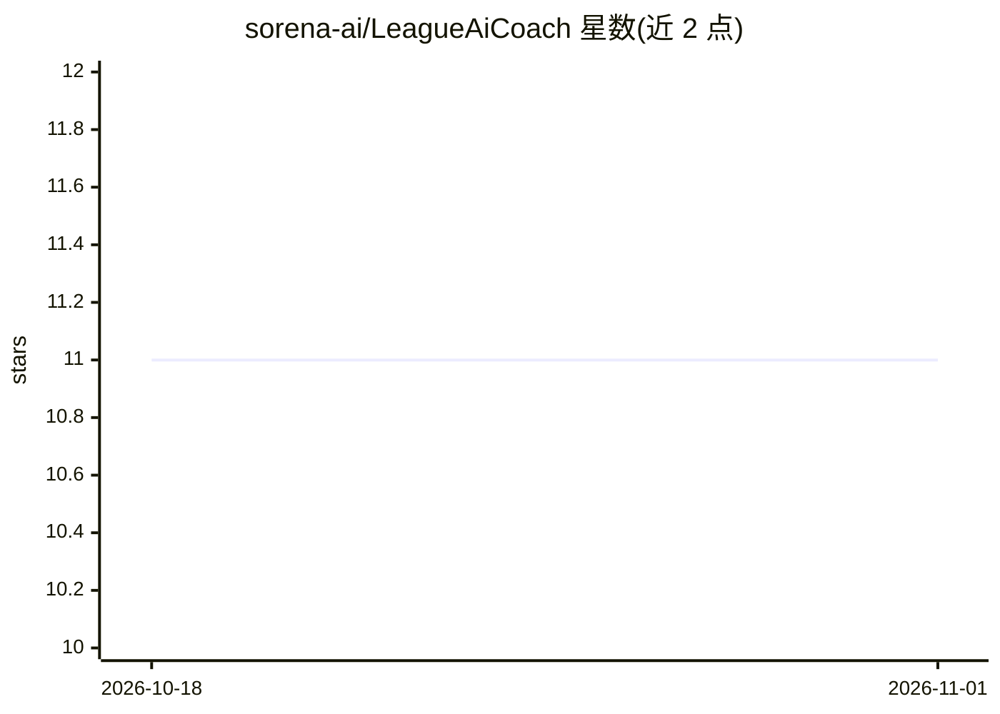

# sorena-ai/LeagueAiCoach

⭐ 11 · Python · Apache-2.0 · 推送 2026-10-13 · [GitHub](https://github.com/sorena-ai/LeagueAiCoach) · [官网](https://Sensii.gg) · 组织维护

**给 LOL 玩家的语音 AI 教练服务：截图+语音提问，返回语音建议**

基于 FastAPI 的后端服务：接收游戏内截图与语音问题，用 OpenAI Whisper 转录、LangChain 封装的分析模型（Gemini 或 Grok，经 COACH_PROVIDER/COACH_MODEL 环境变量切换，无需改代码）生成建议，再用 OpenAI TTS 以音频形式回复。提供 REST 与 WebSocket（对局实时）端点。冠军数据需自行 clone awesome-league-of-legends 到 data/，运行需配置 OPENAI_API_KEY 及所选提供商的 key；支持 Docker Compose 部署或本地 venv 运行。

## 筛选速览

| 维度 | 判定 | 备注 |
|---|---|---|
| AI 角色 | `ai-native` | 本体是模型或模型工具 |
| 许可风险 | `permissive` | Apache-2.0 |
| 部署形态 | `self-host` | docker 或自建部署 |
| 模型依赖 | locked-api |  |
| 硬件要求 | — | 无带数字的原话,不猜 |
| 安装摩擦 | `low` | 无编译、无系统依赖或容器化 |
| 成熟度 | — | 结构信号不足 |

## 能力要点

- 截图+语音输入，输出音频形式的教练建议
- 教练提供商可在 Gemini 与 Grok 间通过环境变量切换
- 提供 WebSocket 对局实时端点（live）
- Docker Compose 与本地 venv 两种运行方式

## 适用场景

- 对局中用语音提问获得英雄与出装建议
- 作为 Sensii 类语音教练应用的 API 后端
- 接入游戏数据 JSON 获取针对当前局势的建议

## 场景标签

`语音 Agent` · 领域:对话与助手

## 证据(README 行号)

> L11: FastAPI service that ingests an in-game screenshot plus a voice question, runs the coach model, and replies with au
> L91: - Live: `WS /api/v1/assistant/live` (in-game realtime; turn.start requires game_stats)

## 星数曲线

2026-10-18 11 → 2026-11-01 11（+0）

---
*卡片 v1 · prompt 1.4 · 生成 2026-11-01 · 置信度 mid · 依据 README sha `faa351ea575a` · [字段定义](../../DATASET.md)*
