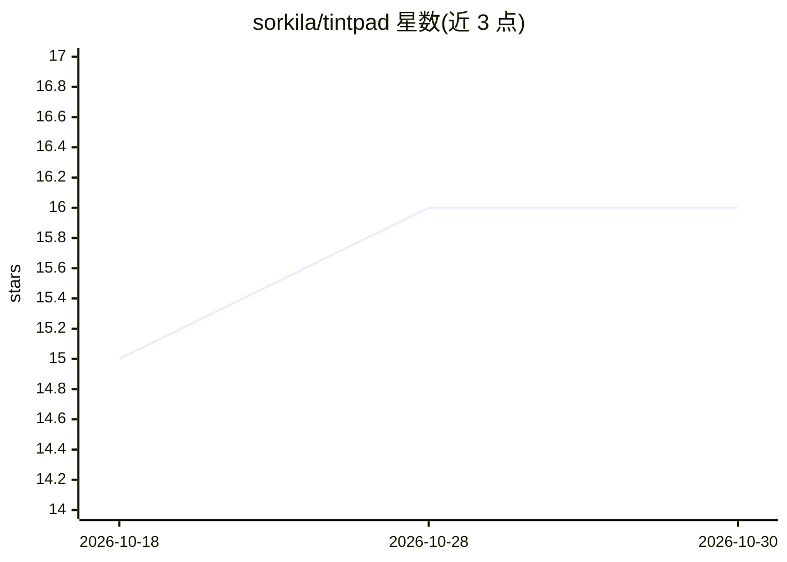

# sorkila/tintpad

⭐ 16 · Swift · MIT · 推送 2026-10-28 · [GitHub](https://github.com/sorkila/tintpad) · [官网](https://tintpad.com) · 个人维护

**从 MacBook 刘海弹出的 macOS 启动器：快捷键直达仓库并启动 agent**

面向 macOS 14+ 的菜单栏/刘海启动器，Swift 6 编写，MIT 许可，本地运行无账号无遥测。按 ⌥⌘Space 唤出下拉条，模糊搜索仓库后回车，在用户已有终端（Ghostty/iTerm2/kitty/WezTerm/Alacritty/Terminal/Warp）中以指定 agent（Claude Code、Codex 或任意 CLI）打开。agent 由用户自行安装，Tintpad 只负责启动；提供 frecency 排序、worktree 后台派发、危险模式确认、命令模板变量（可 shell 转义）等。提供签名公证的 dmg 与 Homebrew 安装。

## 筛选速览

| 维度 | 判定 | 备注 |
|---|---|---|
| AI 角色 | `ai-enhanced` | 去掉 AI 部分产品仍成立 |
| 许可风险 | `permissive` | MIT |
| 部署形态 | `desktop` | 安装包/桌面程序 |
| 模型依赖 | — | README 未给出锁定关系 |
| 硬件要求 | — | 无带数字的原话,不猜 |
| 安装摩擦 | `low` | 无编译、无系统依赖或容器化 |
| 成熟度 | — | 结构信号不足 |

## 能力要点

- 快捷键→仓库→回车即在既有终端中启动指定 agent
- 支持 Ghostty/iTerm2/kitty/WezTerm/Alacritty/Terminal/Warp 七种终端
- 任意 CLI agent 可通过命令模板一行接入
- 本地运行，无账号、无遥测；修复 GUI 应用不继承 shell PATH 的问题

## 适用场景

- 在多个代码仓库间用快捷键快速唤起带 agent 的终端会话
- 在 git worktree 中后台派发 agent 任务并在完成时提醒
- 为 Claude Code / Codex 等配置跳过权限前的红色警示确认

## 场景标签

 · 领域:macOS 开发者工具/启动器

## 证据(README 行号)

> L7: A free, open source macOS launcher for Claude Code and Codex.
> L40: You bring the agent: install `claude`, `codex` or any other agent CLI first.

## 星数曲线

2026-10-18 15 → 2026-10-30 16（+1）

---
*卡片 v1 · prompt 1.4 · 生成 2026-10-30 · 置信度 high · 依据 README sha `4aa85565ec7b` · [字段定义](../../DATASET.md)*
