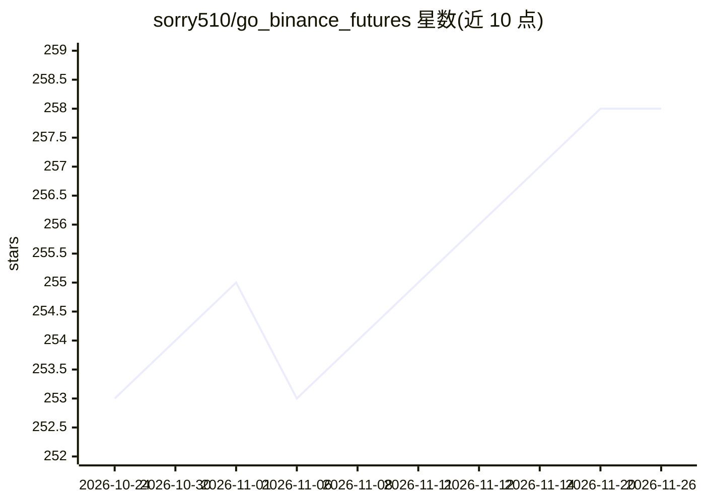

# sorry510/go_binance_futures

⭐ 258 · Go · MIT · 推送 2026-11-23 · [GitHub](https://github.com/sorry510/go_binance_futures) · 个人维护 · 中文 README

**面向加密交易者的币安合约量化、回测与 AI Agent 系统**

一个币安量化交易系统，覆盖合约与现货自动交易、历史回测、实时模拟盘、行情监控与价格提醒，并集成 AI 功能模块（Chat、分析、Skill、MCP、Memory、任务与治理）。提供 Web UI，配套多份分模块文档说明安装初始化、策略模板、带单账户、币本位合约（COIN-M）等内容。面向进行币安合约/现货自动化交易的用户，README 明确声明不构成投资建议。

## 筛选速览

| 维度 | 判定 | 备注 |
|---|---|---|
| AI 角色 | `ai-enhanced` | 去掉 AI 部分产品仍成立 |
| 许可风险 | `permissive` | MIT |
| 部署形态 | `None` |  |
| 模型依赖 | — | README 未给出锁定关系 |
| 硬件要求 | — | 无带数字的原话,不猜 |
| 安装摩擦 | `low` | 无编译、无系统依赖或容器化 |
| 成熟度 | — | 结构信号不足 |

## 能力要点

- 合约与现货自动交易、历史回测与实时模拟盘
- AI 模块：Chat、分析、Skill、MCP、Memory、任务与治理
- 行情监控：价格提醒、资金费率、新币抢购与通知
- 支持币本位合约（COIN-M）独立 DAPI 交易

## 适用场景

- 在币安合约/现货上运行自动交易策略
- 用历史数据回测并实时模拟盘验证策略
- 通过 AI 对话分析行情并设置价格提醒

## 场景标签

`金融量化` · 领域:学习与行业

## 证据(README 行号)

> L8: # 币安量化交易
> L23: |07|AI 与 Agent 功能|Chat、分析、Skill、MCP、Memory、任务与治理|

## 星数曲线

2026-10-24 253 → 2026-11-26 258（+5）

---
*卡片 v1 · prompt 1.4 · 生成 2026-11-25 · 置信度 mid · 依据 README sha `9aa584c92663` · [字段定义](../../DATASET.md)*
