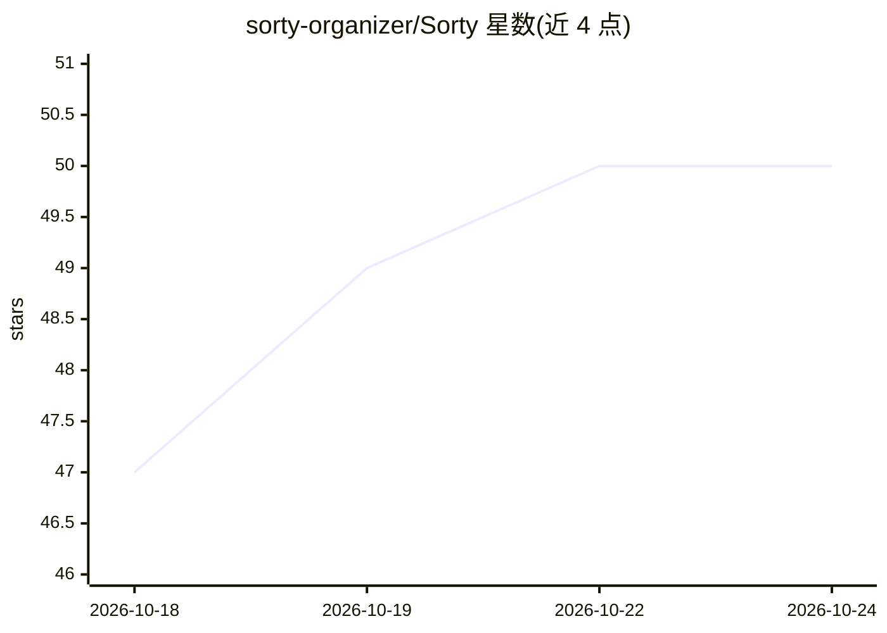

# sorty-organizer/Sorty

⭐ 51 · Swift · GPL-3.0 · 推送 2026-10-24 · [GitHub](https://github.com/sorty-organizer/Sorty) · [官网](https://sorty-organizer.github.io/Sorty/) · 组织维护

**用 AI 自动整理 macOS 文件夹的原生 SwiftUI 应用**

面向 macOS 用户的文件整理工具：读取文件内容与上下文，将文件归类到语义化命名文件夹，支持 OpenAI、Anthropic、Gemini、Groq、OpenRouter、Ollama、OpenAI 兼容端点及 Apple Foundation Models（on-device）等多种 AI 提供方。提供移动前交互预览、重复文件审查、组织历史与回滚、Finder 右键扩展、Watched Folders 后台监控。Learnings Profile 从现有结构和手动修正中被动学习以改进建议。提供预编译 zip（未公证，需手动清除 quarantine）与 Xcode/make 源码构建两种安装方式；构建需 macOS 15.0+ 与 Xcode 16.0+。另可将 Sorty skill 安装到 Codex、Claude Code 等 agent 中脱离应用运行组织工作流。

## 筛选速览

| 维度 | 判定 | 备注 |
|---|---|---|
| AI 角色 | `ai-enhanced` | 去掉 AI 部分产品仍成立 |
| 许可风险 | `viral` | GPL-3.0 |
| 部署形态 | `desktop` | 安装包/桌面程序 |
| 模型依赖 | local-ok | 支持本地模型 |
| 硬件要求 | — | 无带数字的原话,不猜 |
| 安装摩擦 | `low` | 无编译、无系统依赖或容器化 |
| 成熟度 | — | 结构信号不足 |

## 能力要点

- 多 AI 提供方支持（OpenAI/Anthropic/Gemini/Groq/OpenRouter/Ollama/Apple Foundation Models）
- 移动前交互预览、重复文件审查与组织历史回滚
- Learnings Profile 从现有文件夹结构与手动修正中被动学习
- Finder 右键扩展、sorty:// deeplinks 与 Watched Folders 后台监控

## 适用场景

- 自动把下载或工作目录里的文件归入语义化命名的文件夹
- 整理前逐条预览并调整文件移动方案
- 审查并安全清理重复文件

## 场景标签

 · 领域:桌面效率工具/文件管理

## 证据(README 行号)

> L8: A native macOS SwiftUI app that uses AI to organize files into relevant, semantically named folders.
> L21: - **Multiple AI Providers**:
> L22:  - OpenAI, OpenCode Zen and Go, Anthropic, Gemini, Groq, OpenRouter, Ollama, and custom OpenAI-compatible endpoints

## 星数曲线

2026-10-18 47 → 2026-10-24 50（+3）

---
*卡片 v1 · prompt 1.4 · 生成 2026-10-24 · 置信度 high · 依据 README sha `6e3b25c83662` · [字段定义](../../DATASET.md)*
