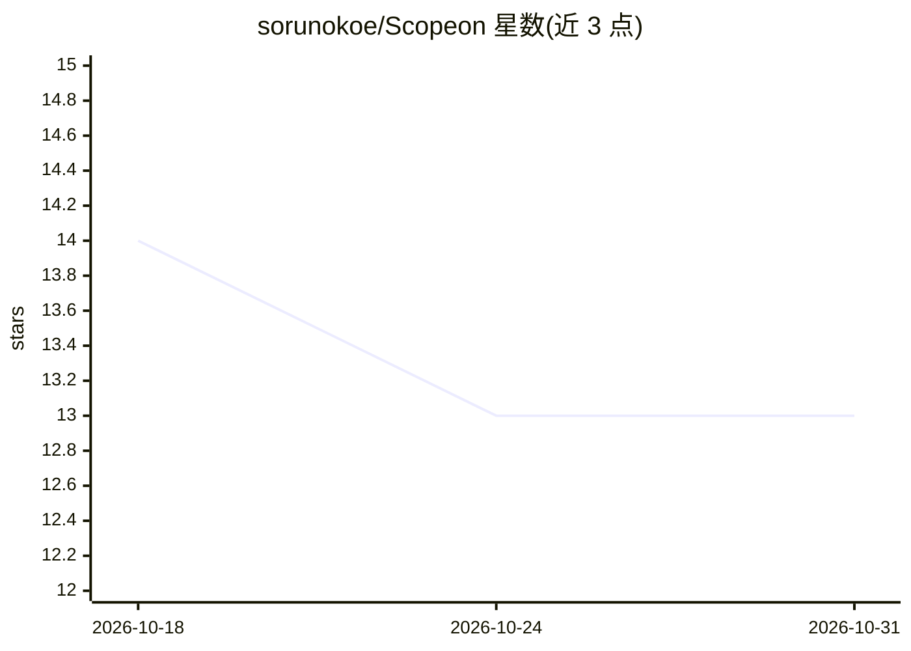

# sorunokoe/Scopeon

⭐ 13 · Rust · 推送 2026-09-16 · [GitHub](https://github.com/sorunokoe/Scopeon) · [官网](https://github.com/sorunokoe/Scopeon/blob/main/docs/README.md) · 个人维护

**给 AI 编码 agent 用户的上下文观测与成本优化 TUI 工具**

面向使用 Claude Code、Copilot CLI、Codex CLI、Gemini CLI、Cursor 等编码 agent 的开发者，Scopeon 本地读取其会话日志（仅 token 计数与成本，不含提示文本），提供 TUI 仪表盘：逐轮成本拆分、上下文填充率与剩余轮次估算、prompt 缓存命中率、MCP 与技能调用树、14 天趋势图。优化侧提供 most-savings/balanced 等一键预设写入各 provider 配置，另有 CI 成本门禁、基于 git log 的团队成本统计、scopeon serve 浏览器面板与 Prometheus/OTLP 桥接。无云端后端与遥测，Rust 实现（MSRV 1.88），提供预编译二进制与 cargo/curl 安装。

## 筛选速览

| 维度 | 判定 | 备注 |
|---|---|---|
| AI 角色 | `ai-ecosystem` | LLM/agent 周边工具 |
| 许可风险 | `permissive` | — |
| 部署形态 | `library` | 以包/库形式分发 |
| 模型依赖 | local-ok | 支持本地模型 |
| 硬件要求 | — | 无带数字的原话,不猜 |
| 安装摩擦 | `low` | 无编译、无系统依赖或容器化 |
| 成熟度 | — | 结构信号不足 |

## 能力要点

- 自动发现 8 类编码 agent 的日志文件，逐轮拆分 token 与成本
- 一键 provider 优化预设（most-savings/balanced/most-speed/most-power）
- CI 成本门禁命令 scopeon ci report --fail-on-cost-delta
- scopeon serve 提供 WebSocket 面板与 SSE 流，另支持 Prometheus/OTLP

## 适用场景

- 查看每次会话/项目/分支的 AI 成本与上下文消耗
- 在 CI 中拦截成本异常的 PR
- 给 Claude Code 等 agent 挂上 MCP 让其自查 token 统计
- 团队从 git 历史统计各成员 AI 花费

## 场景标签

`LLM 可观测性` · 领域:评测与运维

## 证据(README 行号)

> L30: |"Why is this session so expensive?"|Turn-by-turn cost breakdown with waste signals|
> L188: Claude Code · GitHub Copilot CLI · OpenAI Codex CLI · Aider · Cursor · Gemini CLI · Ollama · Generic OpenAI
> L195: - **Local-first** — no cloud backend, no accounts, no API keys required

## 星数曲线

2026-10-18 14 → 2026-10-31 13（-1）

---
*卡片 v1 · prompt 1.4 · 生成 2026-10-31 · 置信度 high · 依据 README sha `abe54a5f2aad` · [字段定义](../../DATASET.md)*
