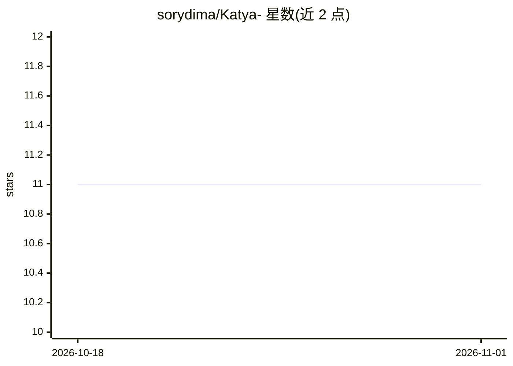

# sorydima/Katya-

⭐ 11 · Dart · GPL-3.0 · 推送 2026-05-12 · [GitHub](https://github.com/sorydima/Katya-) · [官网](https://katya.rechain.network) · 个人维护

**Flutter/Dart 构建的多平台社交区块链应用 Katya®**

Katya® 是一个以 Flutter/Dart 开发的多平台社交区块链应用，目录结构覆盖 android/ios/linux/macos/windows/web 等多个目标平台。README 为俄语，主要内容为快速起步（git clone、flutter pub get、flutter run）、项目目录说明（docs、reports、research）与 MIT 许可声明。AI 能力仅在标题与仓库描述中以宣传性文字提及（advanced AI brain），README 可见部分未给出具体 AI 功能、模型或接口的事实描述。

## 筛选速览

| 维度 | 判定 | 备注 |
|---|---|---|
| AI 角色 | `ai-enhanced` | 去掉 AI 部分产品仍成立 |
| 许可风险 | `viral` | GPL-3.0 |
| 部署形态 | `None` |  |
| 模型依赖 | — | README 未给出锁定关系 |
| 硬件要求 | — | 无带数字的原话,不猜 |
| 安装摩擦 | `low` | 无编译、无系统依赖或容器化 |
| 成熟度 | — | 结构信号不足 |

## 能力要点

- Flutter/Dart 多平台目录结构（android/ios/linux/macos/windows/web/winuwp/aurora）
- 附带 docs、reports、research 文档目录
- MIT 许可

## 适用场景

- 作为 Flutter 多平台应用模板研究项目结构
- 查看其 docs 目录获取进一步文档

## 场景标签

 · 领域:社交/区块链应用

## 证据(README 行号)

> L1: # Katya® - Ultimate AI Multifunctional Social Blockchain Platform
> L16: - Платформы: `android/`, `ios/`, `linux/`, `macos/`, `windows/`, `web/`, `winuwp/`, `aurora/`

## 星数曲线

2026-10-18 11 → 2026-11-01 11（+0）

---
*卡片 v1 · prompt 1.4 · 生成 2026-11-01 · 置信度 low · 依据 README sha `9513cf1ac50e` · [字段定义](../../DATASET.md)*
