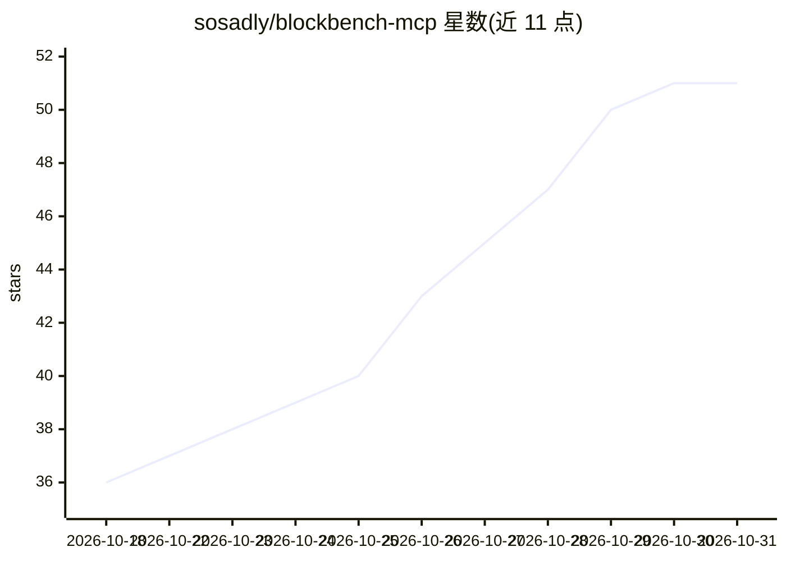

# sosadly/blockbench-mcp

⭐ 51 · JavaScript · MIT · 推送 2026-10-28 · [GitHub](https://github.com/sosadly/blockbench-mcp) · 个人维护

**让 AI 助手直接操作 Blockbench 制作 Minecraft 模型的 MCP server**

由 MCP server 与 Blockbench 插件两部分组成：插件在桌面版 Blockbench 内监听 127.0.0.1:8787 的本地 HTTP 端点，Node 进程以 stdio transport 将 Blockbench 暴露为 70 个 MCP 工具，供 Claude Code、Claude Desktop、Cursor 等 MCP 客户端调用。AI 可创建 Java/Bedrock/GeckoLib 模型、逐像素绘制贴图、搭建骨架、生成关键帧动画、安装 Blockbench 插件并截图自检，含复杂度审计、人审阻断、参考图 IoU 比对等质量门控。需要 Blockbench 桌面版 4.8+ 与 Node.js 18+，网页版无法承载桥接端点。

## 筛选速览

| 维度 | 判定 | 备注 |
|---|---|---|
| AI 角色 | `ai-ecosystem` | LLM/agent 周边工具 |
| 许可风险 | `permissive` | MIT |
| 部署形态 | `library` | 以包/库形式分发 |
| 模型依赖 | locked-api |  |
| 硬件要求 | — | 无带数字的原话,不猜 |
| 安装摩擦 | `low` | 无编译、无系统依赖或容器化 |
| 成熟度 | — | 结构信号不足 |

## 能力要点

- 70 个 MCP 工具覆盖建模、细节、贴图、绑骨、动画与导出
- 插件在本机 8787 端口承载桥接，MCP server 以 stdio 接入 AI 客户端
- voxelize_matrix、generate_array、extrude_chain 等程序化细节工具代替 LLM 做几何计算
- request_review 人审阻断与 compare_reference 参考图 IoU 比对等质量门控

## 适用场景

- 让 Claude/Cursor 等助手在我的 Blockbench 里直接生成带贴图和动画的 Minecraft 模型
- 通过参考图比对让 AI 迭代模型外形直至轮廓匹配
- AI 自动搭建可弯曲四肢的骨架并生成走跑攻击等基础动画循环

## 场景标签

`GUI 自动化` · 领域:效率与自动化

## 证据(README 行号)

> L15: **Blockbench MCP** is an open-source Model Context Protocol server that connects AI assistants such as **Claude Cod
> L57: |**Bridge plugin** (`plugin/blockbench_mcp.js`)|Inside Blockbench (desktop)|Hosts a local HTTP endpoint on `127.0.0
> L58: |**MCP server** (`src/` → `dist/`)|A Node process your AI client launches|Exposes Blockbench as MCP tools (stdio tr

## 星数曲线

2026-10-18 36 → 2026-10-31 51（+15）

---
*卡片 v1 · prompt 1.4 · 生成 2026-10-25 · 置信度 high · 依据 README sha `9a3d36a44e6a` · [字段定义](../../DATASET.md)*
