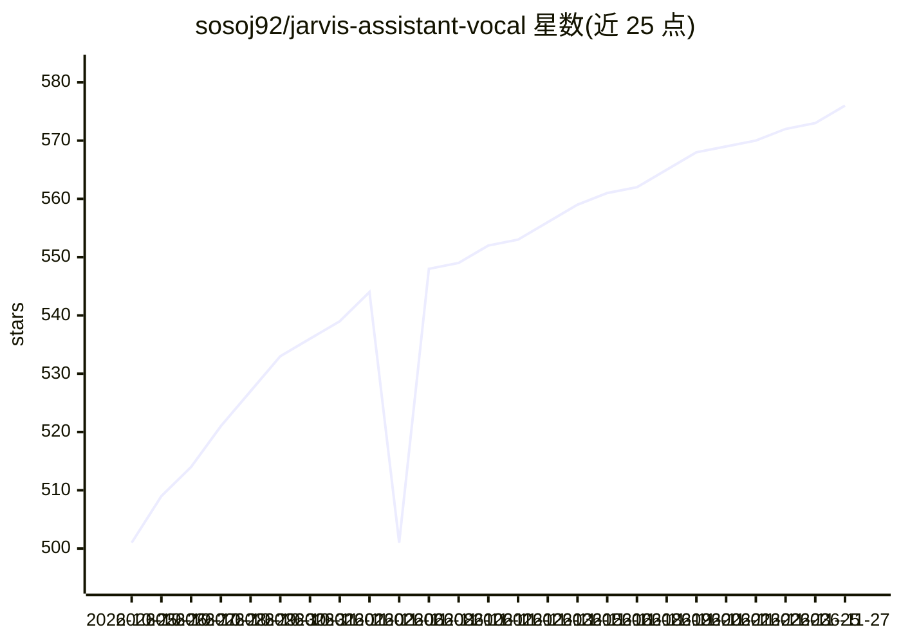

# sosoj92/jarvis-assistant-vocal

⭐ 576 · Python · MIT · 推送 2026-11-18 · [GitHub](https://github.com/sosoj92/jarvis-assistant-vocal) · 个人维护

**本地运行的法语语音助手，接 Claude/Ollama 控制家居、OBS、日程**

以 Python 编写的本地法语语音助手：说出唤醒词后用 LLM 推理并调用可扩展工具集，包含语音唤醒（openWakeWord）、本地转写（faster-whisper）、语音合成，以及 Philips Hue、OBS、Google 日历、Gmail、Discord、浏览器（Playwright）、Twilio 电话等集成。提供三种模式：hybride（云+本地）、qualité（云最强模型）、local（Ollama 离线）。支持委派给本地运行于 Docker 的 Hermes 协商式 agent 做深度思考，自身保留密钥与执行权。目标用户是希望在自有机器上运行语音助手的个人；README 标明为按原样分享的个人项目，面向 Windows 11，多数集成未配置时可自动停用。

## 筛选速览

| 维度 | 判定 | 备注 |
|---|---|---|
| AI 角色 | `ai-native` | 本体是模型或模型工具 |
| 许可风险 | `permissive` | MIT |
| 部署形态 | `None` |  |
| 模型依赖 | local-ok | 支持本地模型 |
| 硬件要求 | — | 无带数字的原话,不猜 |
| 安装摩擦 | `low` | 无编译、无系统依赖或容器化 |
| 成熟度 | `idea` | |

## 能力要点

- 三种模式切换：hybride / qualité / 100% 本地离线（Ollama + 本地语音）
- 语音链路本地：openWakeWord 唤醒、faster-whisper 转写、Piper/Kokoro 合成
- Hermes 本地协商式 agent 委派思考，凭证不进入其环境
- 内置 MCP 服务器，向 Claude Desktop 等客户端暴露工具

## 适用场景

- 语音控制 Philips Hue 灯光与家庭场景
- 语音操作 OBS 直播、录屏与场景切换
- 离线环境下运行不依赖云 API 的语音助手
- 让语音助手代订餐厅或管理浏览器标签页

## 场景标签

`语音 Agent` `浏览器自动化` · 领域:效率与自动化

## 证据(README 行号)

> L10: Un assistant vocal en français qui tourne **sur ta machine**. Dis *« Hey Jarvis »*,
> L52: - 🎙️ **Tout à la voix** — mot d'activation (openWakeWord), transcription locale (Whisper), réponses parlées
> L71: - 🔌 **Serveur MCP** — expose les outils domotique/PC à tout client MCP (Claude Desktop, Hermes…)

## 星数曲线

2026-10-25 501 → 2026-11-27 576（+75）

---
*卡片 v1 · prompt 1.4 · 生成 2026-11-25 · 置信度 high · 依据 README sha `63ff6b39766e` · [字段定义](../../DATASET.md)*
