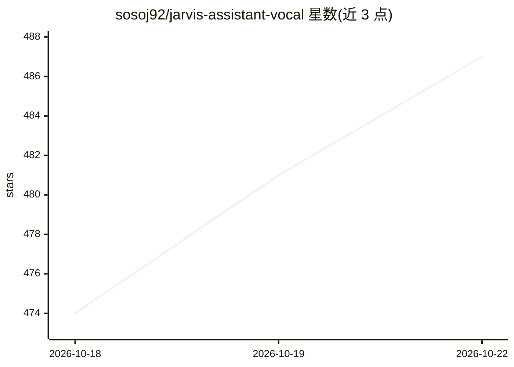

# sosoj92/jarvis-assistant-vocal

⭐ 487 · Python · MIT · 推送 2026-10-20 · [GitHub](https://github.com/sosoj92/jarvis-assistant-vocal) · 个人维护 · 中文 README

**法语本地语音助手：语音唤起、LLM 推理、控制家庭与 PC**

Python 编写的个人语音助手，运行在用户自己的 Windows 11 机器上：openWakeWord 唤醒、faster-whisper 本地转录、LLM 推理并语音回复。提供三种模式（hybride/qualité/100% 本地 Ollama），LLM 与语音引擎可分别配置，已集成 OpenAI 与 Claude/Anthropic，Gemini/DeepSeek 连接器在路线图中未实现。功能覆盖 Philips Hue 灯控、OBS 控制、PC 应用与音量、Google 日历、Gmail、Playwright 浏览器自动预订、Twilio 电话、MCP 服务器、长时记忆与多房间音频卫星节点。本地推理需求约为 6 Go 显存。

## 筛选速览

| 维度 | 判定 | 备注 |
|---|---|---|
| AI 角色 | `ai-native` | 本体是模型或模型工具 |
| 许可风险 | `permissive` | MIT |
| 部署形态 | `None` |  |
| 模型依赖 | local-ok | 支持本地模型 |
| 硬件要求 | — | 无带数字的原话,不猜 |
| 安装摩擦 | `low` | 无编译、无系统依赖或容器化 |
| 成熟度 | — | 结构信号不足 |

## 能力要点

- openWakeWord 唤醒 + faster-whisper 本地转录 + 语音回复
- 三种模式：hybride / qualité / 100% 本地（Ollama + 本地语音）
- MCP 服务器将家庭/PC 工具暴露给 Claude Desktop、Hermes 等客户端
- 工具分级安全（N1/N2/N3）、LLM 预算跟踪与到顶自动切回本地

## 适用场景

- 在家里用语音控制 Hue 灯光、OBS 直播和 PC 应用
- 完全离线运行语音助手（Ollama + Whisper + Piper）
- 通过 Siri 快捷指令或网络音频卫星节点远程发指令
- 让 Jarvis 处理日常事务（日程、邮件摘要、餐厅预订、电话）

## 场景标签

 · 领域:个人助理/家庭自动化

## 证据(README 行号)

> L10: Un assistant vocal en français qui tourne **sur ta machine**. Dis *« Hey Jarvis »*,
> L52: - 🎙️ **Tout à la voix** — mot d'activation (openWakeWord), transcription locale (Whisper), réponses parlées

## 星数曲线

2026-10-18 474 → 2026-10-22 487（+13）

---
*卡片 v1 · prompt 1.4 · 生成 2026-10-21 · 置信度 high · 依据 README sha `7daee906ae96` · [字段定义](../../DATASET.md)*
