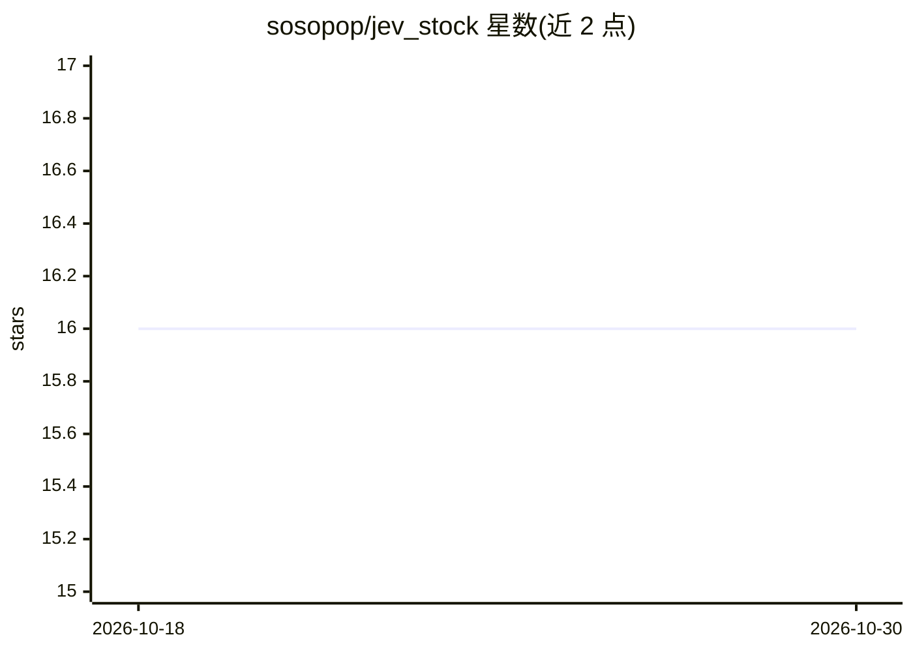

# sosopop/jev_stock

⭐ 16 · Python · 推送 2026-09-17 · [GitHub](https://github.com/sosopop/jev_stock) · 个人维护 · 中文 README

**用 JEV 对港股次日方向做三类预测的实验框架**

输入港股代码后，程序经 AKShare 下载目标股票与恒指、恒生科技指数日线，构建仅含截至日及之前数据的状态（技术指标、月度/周度上下文、可选财务数据），向 TypeSafe JEV 发送结构化请求，获取 up/flat/down 三类方向预测与概率，校验后输出 JSON 与独立 HTML 报告；另提供回测脚本（按日评分、准确率与多类 Brier 分数）。作者明确标注这是实验，概率未校准，不构成投资建议。面向量化研究开发者的 Python 项目，Windows PowerShell 环境下运行。

## 筛选速览

| 维度 | 判定 | 备注 |
|---|---|---|
| AI 角色 | `ai-native` | 本体是模型或模型工具 |
| 许可风险 | `none` | — |
| 部署形态 | `desktop` | 安装包/桌面程序 |
| 模型依赖 | — | README 未给出锁定关系 |
| 硬件要求 | — | 无带数字的原话,不猜 |
| 安装摩擦 | `low` | 无编译、无系统依赖或容器化 |
| 成熟度 | `idea` | |

## 能力要点

- past-only 状态构建：剔除未收盘交易日、月度/周度聚合在截止日后计算以防泄露
- 三类方向预测（±0.3% 阈值，可调）与独立 30 日端点问题
- 回测输出准确率与多类 Brier 分数，附 Wilson 95% 区间
- 生成无 JavaScript/外部 CSS 依赖的独立 HTML 报告

## 适用场景

- 研究 LLM 作为结构化推理层做短期方向分类的效果
- 复现可检查、可版本化的 JEV 股票预测请求状态
- 对比 JEV 预测与简单基线的回测表现

## 场景标签

`金融量化` · 领域:学习与行业

## 证据(README 行号)

> L5: This repository is an experiment in forecasting the next Hong Kong stock-market direction with TypeSafe JEV. You ent
> L44: This boundary matters. The local program does not train a model, update model weights, or infer a probability from 

## 星数曲线

2026-10-18 16 → 2026-10-30 16（+0）

---
*卡片 v1 · prompt 1.4 · 生成 2026-10-30 · 置信度 high · 依据 README sha `eed7d4620571` · [字段定义](../../DATASET.md)*
