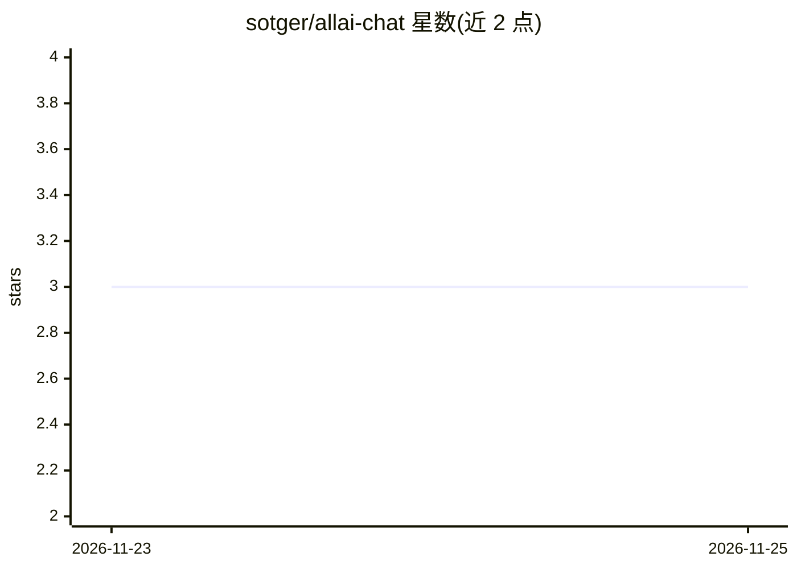

# sotger/allai-chat

⭐ 3 · TypeScript · MIT · 推送 2026-11-22 · [GitHub](https://github.com/sotger/allai-chat) · 个人维护

**AI 网页服务聚合桌面浏览器：多服务独立会话与本地历史搜索**

一个 Electron 桌面应用，将 ChatGPT、Claude、Gemini 等多个 AI 网页服务以垂直标签页方式聚合，每个标签使用独立 partition（独立 cookie/存储），可同服务多账号登录。无需 API key，直接加载真实网站。本地索引已浏览对话，全局搜索覆盖本地索引、当前页面文本及 ChatGPT 服务端历史；支持一键向所有服务发送同一提示词、索引 JSON 备份与通过云盘文件夹同步。安装方式为预构建安装包（macOS DMG/Windows exe/Linux AppImage 与 deb）或源码构建。

## 筛选速览

| 维度 | 判定 | 备注 |
|---|---|---|
| AI 角色 | `ai-ecosystem` | LLM/agent 周边工具 |
| 许可风险 | `permissive` | MIT |
| 部署形态 | `desktop` | 安装包/桌面程序 |
| 模型依赖 | — | README 未给出锁定关系 |
| 硬件要求 | — | 无带数字的原话,不猜 |
| 安装摩擦 | `low` | 无编译、无系统依赖或容器化 |
| 成熟度 | — | 结构信号不足 |

## 能力要点

- 每服务独立 Electron partition，同服务可多账号并存
- 本地对话索引与全局搜索，关闭的聊天仍可检索
- 一键向所有已打开服务发送同一提示词
- 无遥测、无账号、无后端，索引进度与同步均可本地管理

## 适用场景

- 在多个 AI 聊天服务间快速切换而不用多个浏览器窗口
- 同一服务登录多个账号并保持会话隔离
- 搜索并找回之前关闭过的 AI 对话内容

## 场景标签

`聊天机器人` · 领域:对话与助手

## 证据(README 行号)

> L7: **All your AI chats in one desktop app.** ALLAI-CHAT is a small Electron browser
> L8: for ChatGPT, Claude, Gemini, Copilot, Perplexity, DeepSeek, Grok and other AI
> L12: You do not need API keys, and nothing is proxied through a third-party server:

## 星数曲线

2026-11-23 3 → 2026-11-25 3（+0）

---
*卡片 v1 · prompt 1.4 · 生成 2026-11-23 · 置信度 high · 依据 README sha `628c1df3fb0e` · [字段定义](../../DATASET.md)*
