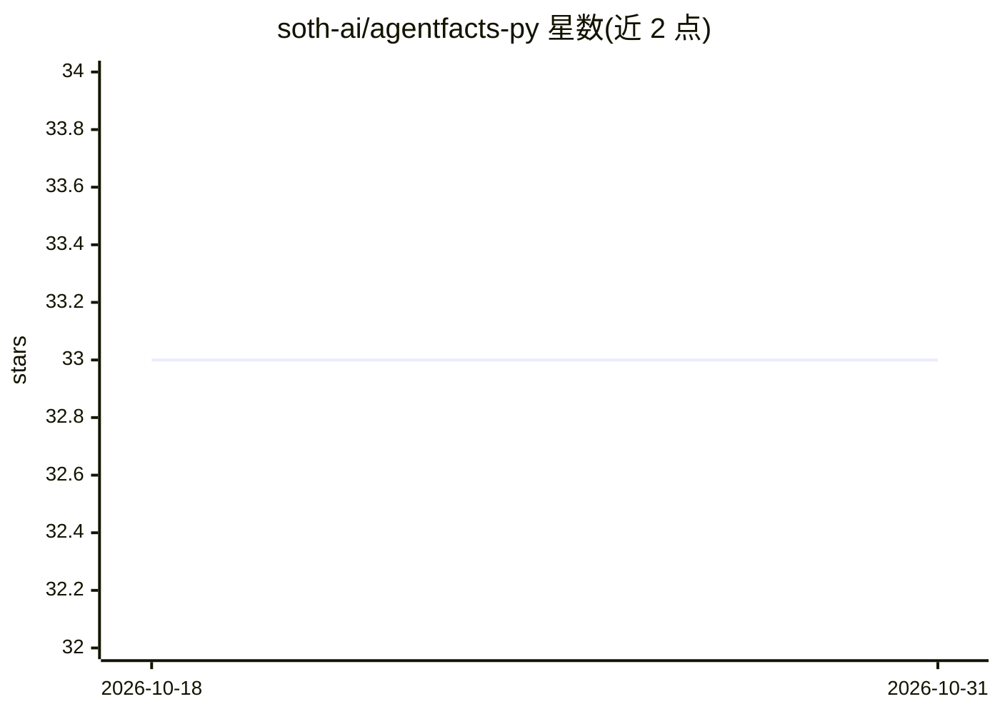

# soth-ai/agentfacts-py

⭐ 33 · Python · MIT · 推送 2026-01-20 · [GitHub](https://github.com/soth-ai/agentfacts-py) · [官网](https://agentfacts.ai/) · 组织维护

**为 AI agent 生成签名可验证身份档案的 Python SDK**

面向开发者的开源 Python SDK：为任意 AI agent 生成包含身份、基础模型、工具、策略与来源信息的 JSON 档案卡，使用 Ed25519 签名与 did:key 去中心化标识符实现可离线验证，并提供 Merkle log 证明做审计追踪。支持 LangChain、LlamaIndex、CrewAI、AutoGen 等 7 类框架的自动元数据内省，附带 CLI 与 FastAPI/Flask 中间件的可选安装。要求 Python 3.10+，MIT 许可。

## 筛选速览

| 维度 | 判定 | 备注 |
|---|---|---|
| AI 角色 | `ai-ecosystem` | LLM/agent 周边工具 |
| 许可风险 | `permissive` | MIT |
| 部署形态 | `library` | 以包/库形式分发 |
| 模型依赖 | — | README 未给出锁定关系 |
| 硬件要求 | — | 无带数字的原话,不猜 |
| 安装摩擦 | `low` | 无编译、无系统依赖或容器化 |
| 成熟度 | — | 结构信号不足 |

## 能力要点

- Ed25519 签名 + did:key 的可离线验证身份档案
- 自动内省 LangChain/LlamaIndex/CrewAI/AutoGen 等框架生成元数据
- Merkle log 证明与零信任策略检查
- RFC 8785 规范化 JSON 保证跨语言一致性

## 适用场景

- 为部署的 agent 签发可验证的身份与能力档案
- 在多方系统中离线核验 agent 的模型与工具声明
- 对 agent 的策略与合规元数据做审计追踪

## 场景标签

`网络安全` · 领域:学习与行业

## 证据(README 行号)

> L9: AgentFacts is an open source SDK that creates a **signed, verifiable profile** for any AI agent. It captures identit
> L45: - **Framework introspection:** Auto-detects popular agent frameworks.

## 星数曲线

2026-10-18 33 → 2026-10-31 33（+0）

---
*卡片 v1 · prompt 1.4 · 生成 2026-10-25 · 置信度 high · 依据 README sha `38446eab6d46` · [字段定义](../../DATASET.md)*
