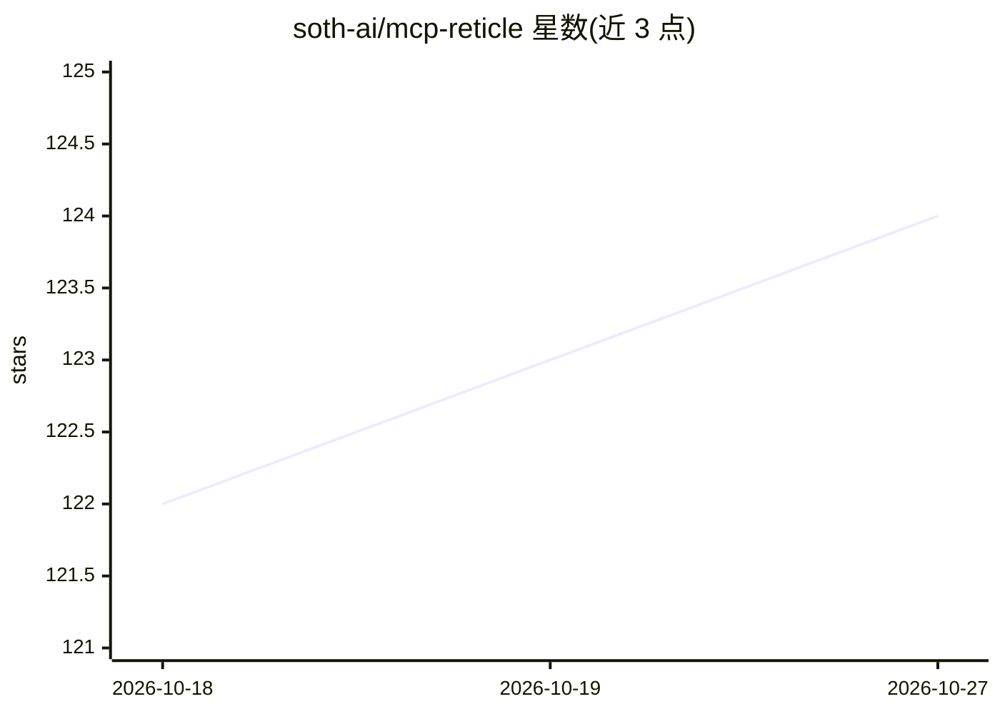

# soth-ai/mcp-reticle

⭐ 124 · Rust · MIT · 推送 2026-01-06 · [GitHub](https://github.com/soth-ai/mcp-reticle) · 组织维护

**MCP JSON-RPC 流量实时拦截、可视化与性能分析工具**

面向调试 Model Context Protocol 集成的代理加 UI 工具：拦截 LLM 与 MCP 服务器之间的 JSON-RPC 流量，实时查看原始请求/通知/响应、即时关联请求与响应、分析延迟与 token 估算、捕获服务器 stderr 与崩溃、录制会话并导出日志。支持 stdio、Streamable HTTP、WebSocket、HTTP/SSE 四种传输。通过 npm 或 PyPI 安装，提供包装 stdio 服务器、反向代理 HTTP 服务器、桌面 UI 与无头守护进程等 CLI 命令，也可从源码构建。

## 筛选速览

| 维度 | 判定 | 备注 |
|---|---|---|
| AI 角色 | `ai-ecosystem` | LLM/agent 周边工具 |
| 许可风险 | `permissive` | MIT |
| 部署形态 | `library` | 以包/库形式分发 |
| 模型依赖 | — | README 未给出锁定关系 |
| 硬件要求 | — | 无带数字的原话,不猜 |
| 安装摩擦 | `low` | 无编译、无系统依赖或容器化 |
| 成熟度 | — | 结构信号不足 |

## 能力要点

- 实时拦截并可视化 MCP JSON-RPC 流量（请求/响应即时关联）
- 延迟与 token 估算的性能分析
- 支持 stdio、Streamable HTTP、WebSocket、HTTP/SSE 四种传输
- 会话录制、日志导出与服务器 stderr/崩溃捕获

## 适用场景

- 调试 agent 与 MCP 服务器之间的通信问题
- 分析 MCP 工具调用的延迟与 token 消耗
- 录制会话留档以排查集成故障

## 场景标签

`LLM 可观测性` · 领域:评测与运维

## 证据(README 行号)

> L23:  Reticle intercepts, visualizes, and profiles MCP JSON-RPC traffic in real time — designed for microsecond-level ov
> L39: Reticle is a proxy + UI for debugging MCP integrations:

## 星数曲线

2026-10-18 122 → 2026-10-27 124（+2）

---
*卡片 v1 · prompt 1.4 · 生成 2026-10-23 · 置信度 high · 依据 README sha `1e08c598f755` · [字段定义](../../DATASET.md)*
