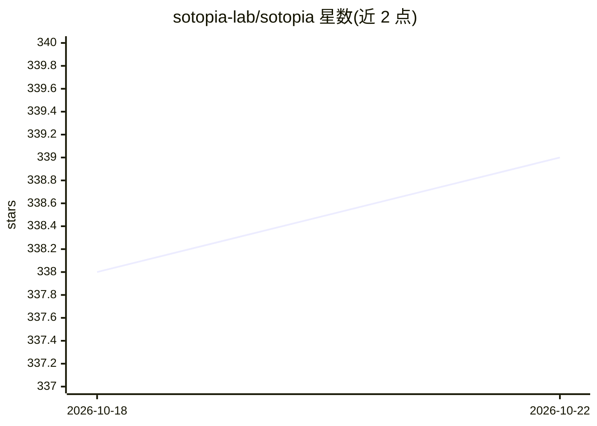

# sotopia-lab/sotopia

⭐ 339 · Python · MIT · 推送 2026-06-05 · [GitHub](https://github.com/sotopia-lab/sotopia) · [官网](https://docs.sotopia.world) · 组织维护

**开放社交学习环境：评测语言 agent 的社交智能**

Sotopia 是一个开放式社交学习环境，让语言 agent 在环境中相互交互，用作评测和培养语言 agent 社交智能的平台；环境设计支持扩展新环境与新 agent，并支持大规模 agent 与环境数量。ICLR 2024 spotlight 论文。安装推荐 uv（pip/conda 亦可），配置 .env（需 OpenAI API key）后运行示例服务器；存储后端可选 Redis（默认，推荐 Docker 部署）或本地 JSON（实验性框架功能需 Redis）。

## 筛选速览

| 维度 | 判定 | 备注 |
|---|---|---|
| AI 角色 | `ai-ecosystem` | LLM/agent 周边工具 |
| 许可风险 | `permissive` | MIT |
| 部署形态 | `self-host` | docker 或自建部署 |
| 模型依赖 | — | README 未给出锁定关系 |
| 硬件要求 | — | 无带数字的原话,不猜 |
| 安装摩擦 | `low` | 无编译、无系统依赖或容器化 |
| 成熟度 | — | 结构信号不足 |

## 能力要点

- 开放式环境，支持扩展新环境与新 agent、可扩展至大量 agent
- 用于评测语言 agent 的社交智能
- 双存储后端：Redis（默认）与本地 JSON
- 提供 Colab、示例脚本（minimalist_demo.py）与数据集

## 适用场景

- 运行多 agent 社交交互仿真并查看 episode 演示
- 评测语言 agent 的社交智能表现
- 在其上开发新的环境与 agent

## 场景标签

 · 领域:LLM agent 评测环境

## 证据(README 行号)

> L22: Sotopia is an open-ended social learning environment that allows agents to interact with each other and the environ
> L25: @inproceedings{zhou2024sotopia,

## 星数曲线

2026-10-18 338 → 2026-10-22 339（+1）

---
*卡片 v1 · prompt 1.4 · 生成 2026-10-21 · 置信度 mid · 依据 README sha `b90d1e4e1f47` · [字段定义](../../DATASET.md)*
