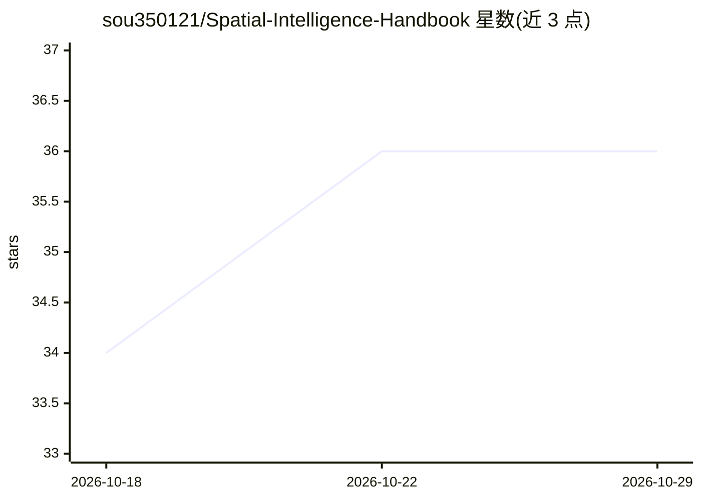

# sou350121/Spatial-Intelligence-Handbook

⭐ 36 · Python · NOASSERTION · 推送 2026-10-28 · [GitHub](https://github.com/sou350121/Spatial-Intelligence-Handbook) · [官网](https://kensou.mintlify.app) · 个人维护 · 中文 README

**跨 embodiment 空间智能（SLAM/VIO/3D 表征）策展手册**

聚焦空间智能问题的知识手册：把 manipulation、driving、aerial、marine 等不同 embodiment 下的 SLAM、VIO、3D 重建、传感器堆叠与部署取舍横向对照，底层共享 3DGS、VGGT、depth foundation 等表示原语。内容由固定管线采集、评级并核查论文后写入，Atlas 含 3,665 条按五轴组织的论文记录，生成沿用 DeepSeek。仓库含 foundations、crossing、embodiments、benchmarks、companies 等九个内容目录，与 VLA-Handbook、Physics-Gen-Handbook 互为姊妹册。

## 筛选速览

| 维度 | 判定 | 备注 |
|---|---|---|
| AI 角色 | `ai-knowledge` | 知识聚合/清单类 |
| 许可风险 | `none` | NOASSERTION |
| 部署形态 | `None` |  |
| 模型依赖 | — | README 未给出锁定关系 |
| 硬件要求 | — | 无带数字的原话,不猜 |
| 安装摩擦 | `low` | 无编译、无系统依赖或容器化 |
| 成熟度 | — | 结构信号不足 |

## 能力要点

- 按 problem/representation/sensor/paradigm/time 五轴组织 3,665 条 Atlas 论文记录
- crossing/ 目录做跨 embodiment（≥3）横向对比并附 Boundary 段
- foundations/ 收齐 3DGS、VGGT、depth foundation、SE(3)/BA 等共享底层内容
- 维护服务器提供每小时核对的正文全文检索

## 适用场景

- 跨 embodiment 转岗的算法工程师查同源问题的不同解法
- 研究者从跨 embodiment failure mode 对比中找选题
- 传感器/硬件团队查阅 SWaP-C 工程账

## 场景标签

`精选清单` · 领域:学习与行业

## 证据(README 行号)

> L11: **A cross-embodiment spatial-AI handbook.**
> L21: - **跨 embodiment 对照.** 把 manipulation / driving / aerial / marine 的同类问题放在 `crossing/` 比较，并明确条件和边界。

## 星数曲线

2026-10-18 34 → 2026-10-29 36（+2）

---
*卡片 v1 · prompt 1.4 · 生成 2026-10-25 · 置信度 high · 依据 README sha `0624aba8aac5` · [字段定义](../../DATASET.md)*
