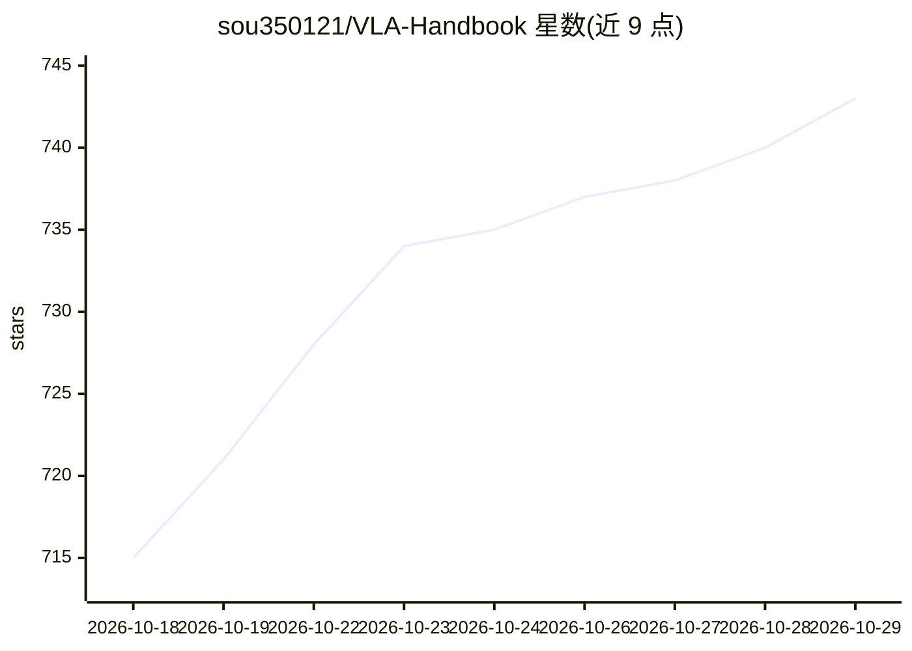

# sou350121/VLA-Handbook

⭐ 743 · HTML · CC-BY-4.0 · 推送 2026-10-28 · [GitHub](https://github.com/sou350121/VLA-Handbook) · 个人维护 · 中文 README

**面向算法工程师的全中文 VLA 学习/面试知识库（754 篇）**

面向进入 VLA（Vision-Language-Action）领域的算法工程师与求职者的中文知识库：整理从论文到复现的入口、参数口径与部署经验，标注来源与未验证项。内容由自动 pipeline（照见 Pulsar）按固定排程抓取论文、评分并生成深度解析，另收录中英文社区实战笔记、GitHub Issues 工程经验蒸馏、双周报告、行业雷达与面试题库；提供 RSS 订阅与可插拔的 AI Skill。内容以自动生成为主，核验状态按条目标注。

## 筛选速览

| 维度 | 判定 | 备注 |
|---|---|---|
| AI 角色 | `ai-knowledge` | 知识聚合/清单类 |
| 许可风险 | `viral` | CC-BY-4.0 |
| 部署形态 | `None` |  |
| 模型依赖 | — | README 未给出锁定关系 |
| 硬件要求 | — | 无带数字的原话,不猜 |
| 安装摩擦 | `low` | 无编译、无系统依赖或容器化 |
| 成熟度 | — | 结构信号不足 |

## 能力要点

- 754 篇理论文档按 10 个主题组织（vla-core/foundation/world-model 等）
- 每日自动抓取论文、评分（⚡/🔧/📖）并生成深度解析
- 中英文社区与 GitHub Issues 部署经验按条目保留来源和时间
- 14 份面试题库 + 18 份双周报告 + 11 份公司档案

## 适用场景

- 系统学习 VLA 领域理论与工程细节，准备面试
- 复现论文时查找入口脚本、超参口径与踩坑经验
- 跟踪机器人/具身智能行业的融资与产品动态
- 通过 RSS 订阅每日新论文解读与周报

## 场景标签

`知识库管理` `教程课程` · 领域:知识与检索

## 证据(README 行号)

> L43: ### 全中文 · 工程实战导向的 VLA 知识库
> L46: 这个 Handbook 做一件事：**整理从论文到复现的入口、参数口径与部署经验，并标出来源、未验证项和适用边界。**
> L48: > **754 篇理论文档**（10 个主题目录） · 中英文社区实战笔记 · GitHub Issues 工程经验 · **18 份双周前沿报告 + 15 份反思** · 行业情报雷达 · 固定排程采集、评分与深度解析

## 星数曲线

2026-10-18 715 → 2026-10-29 743（+28）

---
*卡片 v1 · prompt 1.4 · 生成 2026-10-21 · 置信度 mid · 依据 README sha `fe824f2da664` · [字段定义](../../DATASET.md)*
