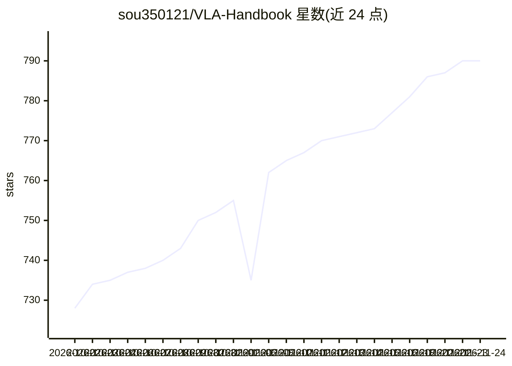

# sou350121/VLA-Handbook

⭐ 793 · HTML · CC-BY-4.0 · 推送 2026-11-24 · [GitHub](https://github.com/sou350121/VLA-Handbook) · 个人维护 · 中文 README

**面向 VLA 算法工程师的全中文学习与面试手册**

面向进入 Vision-Language-Action 领域的算法工程师的知识库：整理 775 份理论文档（10 个主题目录）、真机部署经验、19 份双周报告与面试题库，内容聚合中英文社区笔记与 GitHub Issues 的工程经验，并保留来源、日期与未验证项标注。配套论文流量趋势图、RSS 订阅、行业情报雷达，以及一个可装入 Claude Code / Cursor 等编程助手的 VLA Expert Skill。以 Git 仓库形式提供，按 CC BY 4.0 许可发布。

## 筛选速览

| 维度 | 判定 | 备注 |
|---|---|---|
| AI 角色 | `ai-knowledge` | 知识聚合/清单类 |
| 许可风险 | `viral` | CC-BY-4.0 |
| 部署形态 | `None` |  |
| 模型依赖 | — | README 未给出锁定关系 |
| 硬件要求 | — | 无带数字的原话,不猜 |
| 安装摩擦 | `low` | 无编译、无系统依赖或容器化 |
| 成熟度 | — | 结构信号不足 |

## 能力要点

- 775 份理论文档按 10 个主题目录组织，含论文索引与学习路线图
- 中文社区/英文社区/GitHub Issues 三份实战笔记，条目保留来源与时间
- 19 份双周报告 + 16 份反思，Daily Pulse 提供 15 个方法族的论文趋势图
- VLA Expert Skill 支持装入 Claude Code / Cursor / Codex / OpenCode

## 适用场景

- 系统学习 VLA 架构、动作生成范式与研究主线
- 真机部署前查硬件选型、多模态同步与 Sim2Real 踩坑经验
- 准备 VLA 方向的算法工程师面试（14 份题库）
- 让 AI 编程助手加载 VLA 专家知识辅助论文评估与部署判断

## 场景标签

`知识库管理` `教程课程` · 领域:知识与检索

## 证据(README 行号)

> L40: ### 全中文 · 工程实战导向的 VLA 知识库
> L43: 这个 Handbook 做一件事：**整理从论文到复现的入口、参数口径与部署经验，并标出来源、未验证项和适用边界。**
> L45: > **775 份理论文档**（10 个主题目录） · 中英文社区实战笔记 · GitHub Issues 工程经验 · **19 份双周前沿报告 + 16 份反思** · 行业情报雷达 · 论文解读与工程经验

## 星数曲线

2026-10-22 728 → 2026-11-24 790（+62）

---
*卡片 v1 · prompt 1.4 · 生成 2026-11-24 · 置信度 mid · 依据 README sha `fe88f31fd7b6` · [字段定义](../../DATASET.md)*
