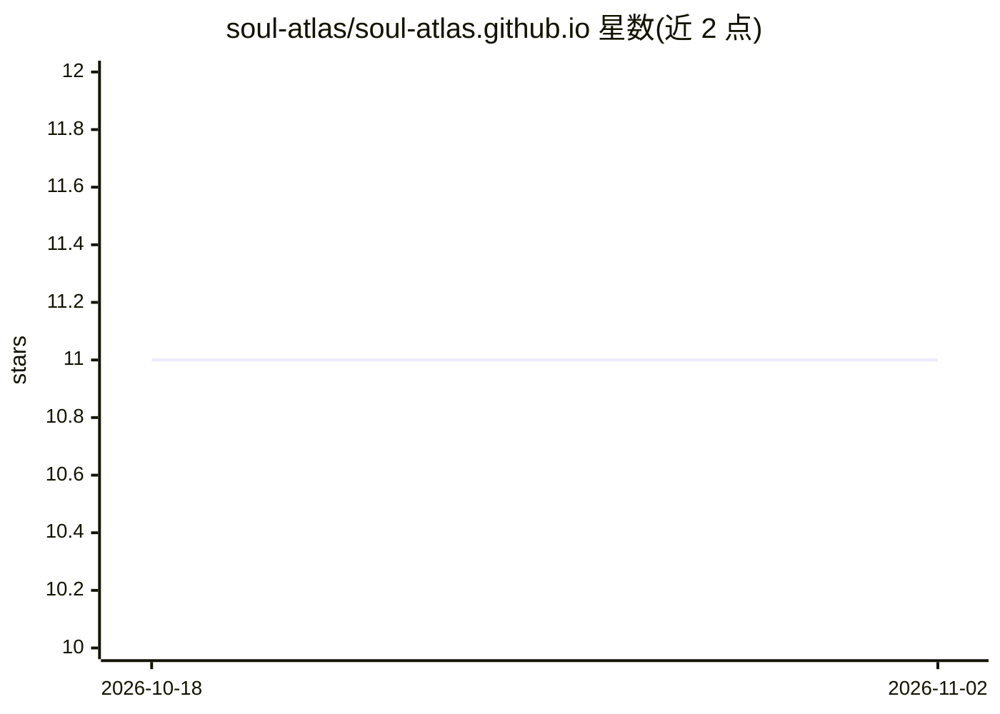

# soul-atlas/soul-atlas.github.io

⭐ 11 · Astro · NOASSERTION · 推送 2026-09-18 · [GitHub](https://github.com/soul-atlas/soul-atlas.github.io) · [官网](https://soul-atlas.github.io) · 组织维护

**开源专家思维画像语料库：SOUL.md 结构化专家推理与决策方式**

社区共建的 SOUL.md 文件集合：每个 SOUL 用结构化 Markdown 刻画一个领域专家的目标、心智模型、决策框架、经验法则、失败模式与工作场景，供人类阅读，也可注入 AI 系统提示词或检索管线。以 100% 静态站点发布，构建时从 souls/ 目录生成网站、JSON API、知识图谱与全文搜索，提供 /llms.txt 全量语料与 bundle 下载（SOUL.md + 可运行 Agent Skills）。初始语料为 AI 起草、标注为草稿待从业者审校。

## 筛选速览

| 维度 | 判定 | 备注 |
|---|---|---|
| AI 角色 | `ai-knowledge` | 知识聚合/清单类 |
| 许可风险 | `permissive` | NOASSERTION |
| 部署形态 | `library` | 以包/库形式分发 |
| 模型依赖 | — | README 未给出锁定关系 |
| 硬件要求 | — | 无带数字的原话,不猜 |
| 安装摩擦 | `low` | 无编译、无系统依赖或容器化 |
| 成熟度 | `idea` | |

## 能力要点

- 300+ 个 SOUL.md，结构化记录专家判断与心智模型
- 静态 JSON API + /llms-full.txt 全量语料，MIT 许可并明确欢迎 AI 训练
- 部分 SOUL 附带可运行 Agent Skills（bundle.zip 下载）
- 知识图谱、对比视图与全文搜索的静态网站

## 适用场景

- 查找某职业专家的思维方式与决策框架
- 把 SOUL.md 注入系统提示词或 RAG 管线以接地模型回答
- 下载含 Agent Skills 的 bundle 装备 Claude Code 等 skill 感知运行时

## 场景标签

`提示工程` `知识图谱` `精选清单` · 领域:Agent 开发

## 证据(README 行号)

> L9: An open, community-built collection of `SOUL.md` files — each one a portrait of how
> L139: A `SOUL.md` is just Markdown, so it drops into the system prompt of *any* model — or

## 星数曲线

2026-10-18 11 → 2026-11-02 11（+0）

---
*卡片 v1 · prompt 1.4 · 生成 2026-11-01 · 置信度 high · 依据 README sha `b4e38b975a9c` · [字段定义](../../DATASET.md)*
