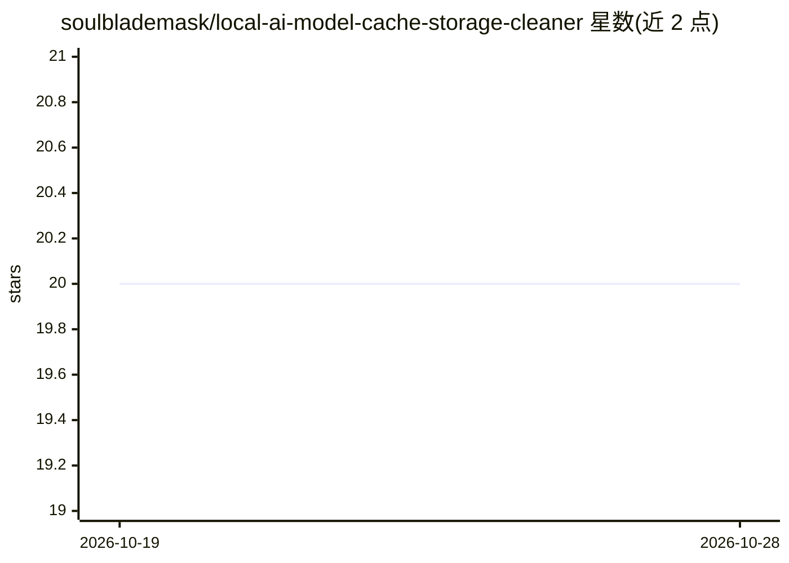

# soulblademask/local-ai-model-cache-storage-cleaner

⭐ 20 · CSS · MIT · 推送 2026-10-19 · [GitHub](https://github.com/soulblademask/local-ai-model-cache-storage-cleaner) · 个人维护

**Windows 本地 AI 模型缓存与存储清理工具**

以 ZIP 发布的 Windows 可执行工具，围绕本地 AI 工作流的模型存储清理、未使用本地模型检查与 AI 缓存清理组织功能，提供可复用配置档案、修改前备份与恢复工作流（选择/检测→分析→应用→验证→还原）。声明为独立工具，非 Ollama、NVIDIA、AMD、微软或模型提供商的官方产品，也不包含商业 AI 模型。安装方式为从 GitHub Releases 下载 ZIP 解压运行 exe。

## 筛选速览

| 维度 | 判定 | 备注 |
|---|---|---|
| AI 角色 | `ai-ecosystem` | LLM/agent 周边工具 |
| 许可风险 | `permissive` | MIT |
| 部署形态 | `desktop` | 安装包/桌面程序 |
| 模型依赖 | — | README 未给出锁定关系 |
| 硬件要求 | — | 无带数字的原话,不猜 |
| 安装摩擦 | `low` | 无编译、无系统依赖或容器化 |
| 成熟度 | — | 结构信号不足 |

## 能力要点

- 模型存储清理与未使用本地模型的前后对比检查
- 修改前备份与可复用配置档案
- 恢复工作流支持回滚到已知可用配置

## 适用场景

- 清理本地 AI 运行时占用的磁盘空间
- 整理未使用的本地模型与缓存
- 变更配置前保存备份并在出问题时回滚

## 场景标签

 · 领域:系统工具/本地 AI 运维

## 证据(README 行号)

> L19: **Local AI Model Cache & Storage Cleaner** is designed to organize a Windows workflow around **model storage cleanu
> L43: 1. **Select / Detect** — choose the relevant model, runtime, GPU, API, or storage context.

## 星数曲线

2026-10-19 20 → 2026-10-28 20（+0）

---
*卡片 v1 · prompt 1.4 · 生成 2026-10-28 · 置信度 low · 依据 README sha `44e6cd822cf4` · [字段定义](../../DATASET.md)*
