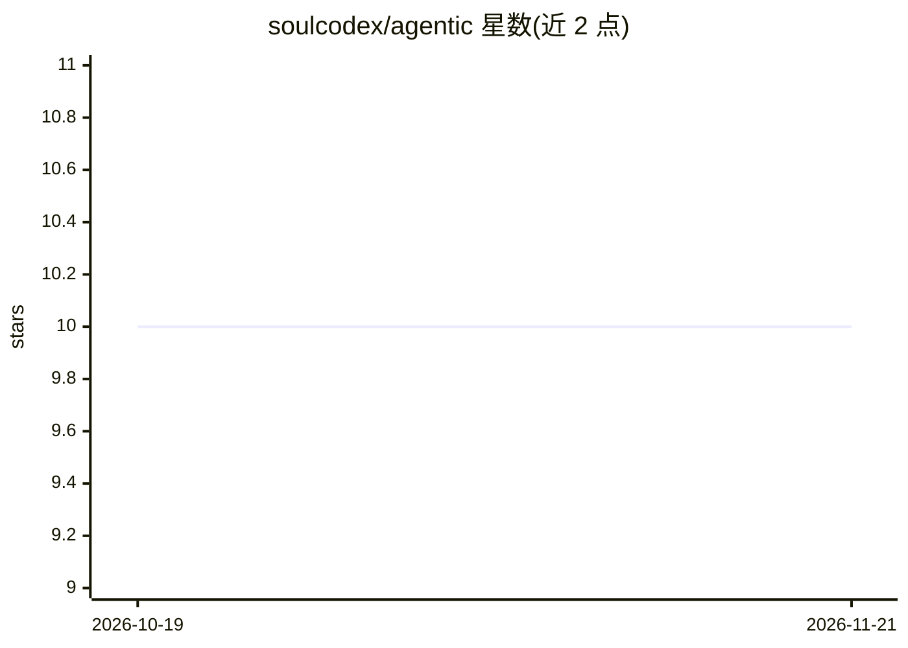

# soulcodex/agentic

⭐ 10 · Shell · MIT · 推送 2026-11-20 · [GitHub](https://github.com/soulcodex/agentic) · [官网](http://agentic.soulcodex.link/) · 组织维护

**统一管理多 AI 编码工具配置的 CLI 与配置库**

以 AGENTS.md 为单一可信来源的配置库与 CLI：提供 24 个现成 profile（覆盖 TypeScript/Go/Python/PHP/HCL 的多种架构）、可组合的 agents/skills，一条 deploy 命令将同一份配置生成/同步到 Claude、GitHub Copilot、Gemini CLI、OpenAI Codex、Opencode、Cursor 等工具的专有格式，避免各工具配置文件漂移与手工多处更新。安装脚本将 CLI 装到 ~/.local/bin，依赖 bash/just/yq/jq；支持 MCP 服务器统一声明与项目级自定义 skills。

## 筛选速览

| 维度 | 判定 | 备注 |
|---|---|---|
| AI 角色 | `ai-ecosystem` | LLM/agent 周边工具 |
| 许可风险 | `permissive` | MIT |
| 部署形态 | `None` |  |
| 模型依赖 | — | README 未给出锁定关系 |
| 硬件要求 | — | 无带数字的原话,不猜 |
| 安装摩擦 | `low` | 无编译、无系统依赖或容器化 |
| 成熟度 | — | 结构信号不足 |

## 能力要点

- 以 AGENTS.md 为单一来源，生成多 AI 工具配置文件
- 24 个现成 profile，覆盖多语言与多种架构
- 支持 MCP 服务器统一声明并生成各 vendor 格式
- deploy/sync/switch 等 CLI 命令实现配置生成与切换

## 适用场景

- 一个项目同时使用多个 AI 编码工具时保持配置一致
- 新项目按语言/架构 profile 快速初始化 agent 配置
- 团队希望集中维护一份 agent 配置而非多处手改

## 场景标签

`提示工程` · 领域:Agent 开发

## 证据(README 行号)

> L5: An opinionated library of composable AGENTS, profiles, skills, and vendor adapters.
> L6: Pick a profile, run one command, and every AI tool in your project reads the same
> L75: Claude, GitHub Copilot, Gemini CLI, OpenAI Codex, Opencode, Cursor (rules-only) — all from one `AGENTS.md`.

## 星数曲线

2026-10-19 10 → 2026-11-21 10（+0）

---
*卡片 v1 · prompt 1.4 · 生成 2026-11-19 · 置信度 high · 依据 README sha `e0f6a2b0bf7b` · [字段定义](../../DATASET.md)*
