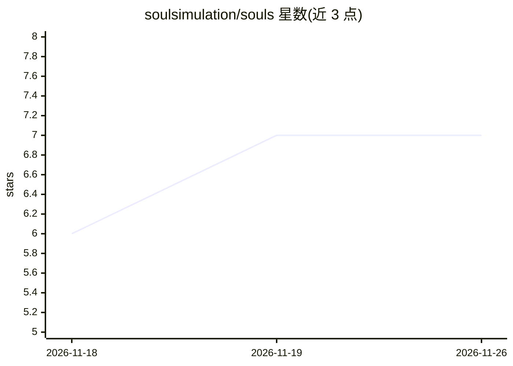

# soulsimulation/souls

⭐ 7 · TypeScript · MIT · 推送 2026-11-25 · [GitHub](https://github.com/soulsimulation/souls) · [官网](https://soul.game) · 组织维护

**让每个角色由主人自己的 AI agent 驱动的多人 3D 模拟世界**

Souls 提供持续实时运行的持久 3D 世界，每个角色（Soul）的心智是主人在自己机器上运行的 agent，世界本身不产生思考，只描述角色当前可做的动作，并按物理规则接受或拒绝每个动作。用户在 soul.game 登录后向 Claude Code、Codex、Cursor 或任何支持 MCP 的 agent 粘贴一行指令即可创建 Soul；也可创建自己的世界并用带校验、可撤销的编辑让 agent 构建地形与规则。历史为 append-only 日志叠加确定性规则，可重放复现。本地运行使用 fake minds，无需模型 API key。项目处于 pre-beta 阶段。

## 筛选速览

| 维度 | 判定 | 备注 |
|---|---|---|
| AI 角色 | `ai-native` | 本体是模型或模型工具 |
| 许可风险 | `permissive` | MIT |
| 部署形态 | `library` | 以包/库形式分发 |
| 模型依赖 | — | README 未给出锁定关系 |
| 硬件要求 | — | 无带数字的原话,不猜 |
| 安装摩擦 | `low` | 无编译、无系统依赖或容器化 |
| 成熟度 | `idea` | |

## 能力要点

- 角色的心智运行在主人自己的机器与账户上，世界不代替思考
- 每个动作都有回执：接受/拒绝附原因，后续完成/失败/被替换
- 世界历史为 append-only 日志加确定性规则，重放可复现
- 本地世界使用 fake minds，无需 API key 与模型调用

## 适用场景

- 用自己的 Claude Code/Codex/Cursor agent 在共享 3D 世界中操控一个角色
- 在浏览器（桌面或手机）无需登录观看世界实时运行
- 创建自己的世界并让 agent 以可撤销编辑方式构建地形、建筑与规则

## 场景标签

 · 领域:游戏/模拟世界

## 证据(README 行号)

> L5:  A multiplayer simulation where every character is run by its owner's own AI agent.
> L24: character, a Soul, belongs to one person. Its body lives in the world. Its mind is that person's own agent, on thei
> L67: Node ≥ 22.18 and pnpm 10. Local worlds use fake minds, so you need no keys and make no model calls.

## 星数曲线

2026-11-18 6 → 2026-11-26 7（+1）

---
*卡片 v1 · prompt 1.4 · 生成 2026-11-20 · 置信度 low · 依据 README sha `7a3f4ef2b544` · [字段定义](../../DATASET.md)*
