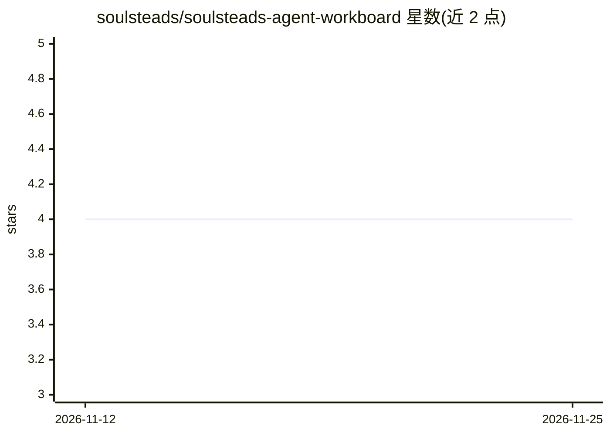

# soulsteads/soulsteads-agent-workboard

⭐ 4 · Rust · Apache-2.0 · 推送 2026-11-23 · [GitHub](https://github.com/soulsteads/soulsteads-agent-workboard) · 个人维护

**给自主 agent 用的共享任务看板：认领、依赖与审计**

用 Rust 编写的单二进制 issue 看板，SQLite 内嵌，面向自主 agent 团队的任务协调：支持 epic/story/bug 等层级、阻塞依赖与环检测、原子任务认领（租约、心跳、过期令牌）、修订号防并发覆盖、幂等重试、SSE 与签名 webhook 推送变更。agent 可通过 JSON CLI、MCP（stdio 每进程一服务器）或带 API key 的 HTTP API 操作 36 种命令；人通过只读实时网页面板跟进，并要求独立复核、不认证外部结果。安装需 Rust 稳定工具链与 C 编译器。

## 筛选速览

| 维度 | 判定 | 备注 |
|---|---|---|
| AI 角色 | `ai-ecosystem` | LLM/agent 周边工具 |
| 许可风险 | `permissive` | Apache-2.0 |
| 部署形态 | `library` | 以包/库形式分发 |
| 模型依赖 | — | README 未给出锁定关系 |
| 硬件要求 | — | 无带数字的原话,不猜 |
| 安装摩擦 | `low` | 无编译、无系统依赖或容器化 |
| 成熟度 | `idea` | |

## 能力要点

- 原子认领机制：租约、心跳、令牌拒绝过期 worker
- 36 种操作经 JSON CLI / MCP / HTTP API 三通道暴露
- SSE 流与签名 webhook 实时推送，租约令牌自动剥离
- 强制独立复核流程，自我复核被拒绝

## 适用场景

- 让多个自主 agent 在同一项目计划上安全认领任务
- 用只读面板实时查看 agent 团队的工作进展
- 为 agent 执行结果建立证据提交与独立复核流程

## 场景标签

`多智能体` · 领域:Agent 开发

## 证据(README 行号)

> L5: A Rust issue board for autonomous agents, with epics, stories, bugs, dependencies,
> L132: ### MCP
> L145: `{"op":"board","project":"AG"}`. The tool's schema describes all 36 operations;

## 星数曲线

2026-11-12 4 → 2026-11-25 4（+0）

---
*卡片 v1 · prompt 1.4 · 生成 2026-11-21 · 置信度 high · 依据 README sha `7658b0ab3f03` · [字段定义](../../DATASET.md)*
