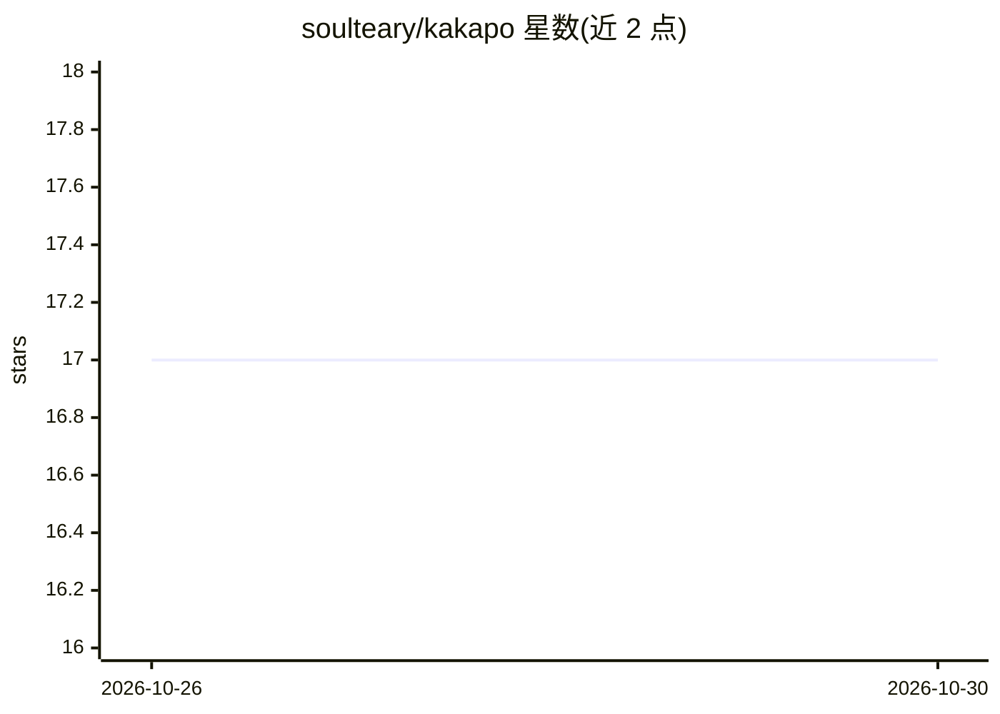

# soulteary/kakapo

⭐ 17 · Go · Apache-2.0 · 推送 2026-10-22 · [GitHub](https://github.com/soulteary/kakapo) · [官网](https://zhuanlan.zhihu.com/p/2045645710469732284) · 个人维护 · 中文 README

**桌面翻译应用：多服务商多模型多目标语言并行对比译文**

基于 Wails v3 / Go 的开源桌面翻译应用（macOS 优先），对接 OpenAI 兼容 Chat Completions 接口（Kimi/Moonshot、DeepSeek、OpenAI 或自定义服务），按“服务商×模型×目标语言”并行执行（并发上限 6）并排展示结果，供比较风格、准确性与延迟。API Key 存入系统 Keychain，历史本地持久化，支持系统朗读。同时作为 Wails v3 桌面工程参考，含托盘、Echo API 等示例；非 macOS 平台部分能力降级或不可用。

## 筛选速览

| 维度 | 判定 | 备注 |
|---|---|---|
| AI 角色 | `ai-native` | 本体是模型或模型工具 |
| 许可风险 | `permissive` | Apache-2.0 |
| 部署形态 | `None` |  |
| 模型依赖 | locked-api |  |
| 硬件要求 | — | 无带数字的原话,不猜 |
| 安装摩擦 | `low` | 无编译、无系统依赖或容器化 |
| 成熟度 | — | 结构信号不足 |

## 能力要点

- 服务商×模型×目标语言并行翻译对比（并发上限 6）
- API Key 独立保存到系统 Keychain，不写入配置文件
- 按模型族自动调参（kimi-k2 / deepseek 系列参数适配）
- 本地翻译历史持久化，支持搜索与结果回放

## 适用场景

- 同一段文本同时发给多个模型/多个目标语言，横向比较译文
- 高频翻译时的桌面常驻工具（托盘窗口）
- 作为 Wails v3 桌面应用工程的参考与二次开发

## 场景标签

 · 领域:桌面翻译工具

## 证据(README 行号)

> L25: Kakapo 是一款开源桌面翻译应用，核心目标不是“调用一次模型给一个答案”，而是把翻译变成可比较、可回放、可迭代的工作流。
> L27: 它可以对接 OpenAI 兼容的 `Chat Completions` 接口，例如 Kimi / Moonshot、DeepSeek、OpenAI 或你自己的兼容服务；翻译时可同时启用多个服务商、多个模型、多个目标语言，并将结果并
> L39: |并行翻译对比|按 `服务商 × 模型 × 目标语言` 并行执行（并发上限 6），便于横向比较输出质量与速度|

## 星数曲线

2026-10-26 17 → 2026-10-30 17（+0）

---
*卡片 v1 · prompt 1.4 · 生成 2026-10-29 · 置信度 high · 依据 README sha `a241a1643bbd` · [字段定义](../../DATASET.md)*
