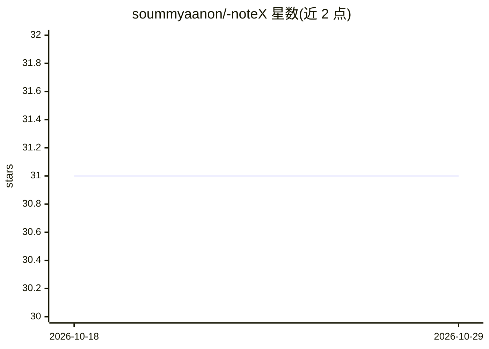

# soummyaanon/-noteX

⭐ 31 · JavaScript · Apache-2.0 · 推送 2026-10-21 · [GitHub](https://github.com/soummyaanon/-noteX) · [官网](https://notex.studio) · 个人维护

**个人 AI 笔记应用（React + Gemini），仍在开发中**

基于 React.js 构建的个人笔记应用，技术栈包含 Appwrite（认证/数据库/存储）、ShadCN-UI、AceternityUI、Framer Motion 与 TailwindCSS，仓库描述称 AI 能力由 Google Gemini Pro 提供。README 仅包含模板式的上手步骤：git clone 克隆、npm install 安装依赖、npm run dev 启动开发服务器。仓库描述声明项目仍在开发阶段，README 未提供功能细节、配置说明或 AI 功能的具体交互方式。

## 筛选速览

| 维度 | 判定 | 备注 |
|---|---|---|
| AI 角色 | `ai-native` | 本体是模型或模型工具 |
| 许可风险 | `permissive` | Apache-2.0 |
| 部署形态 | `library` | 以包/库形式分发 |
| 模型依赖 | — | README 未给出锁定关系 |
| 硬件要求 | — | 无带数字的原话,不猜 |
| 安装摩擦 | `low` | 无编译、无系统依赖或容器化 |
| 成熟度 | — | 结构信号不足 |

## 能力要点

- React + Appwrite（认证/数据库/存储）+ ShadCN-UI 技术栈
- 仓库描述称 AI 能力由 Google Gemini Pro 提供
- 仓库描述声明项目仍处于开发阶段

## 适用场景

- 需要自托管个人笔记应用并接入 Gemini 的开发者可克隆源码运行
- 作为 React + Appwrite 项目模板进行二次开发

## 场景标签

`知识库管理` · 领域:知识与检索

## 证据(README 行号)

> L1: ## Getting Started
> L15:     npm install

## 星数曲线

2026-10-18 31 → 2026-10-29 31（+0）

---
*卡片 v1 · prompt 1.4 · 生成 2026-10-26 · 置信度 low · 依据 README sha `74ab9525a8f8` · [字段定义](../../DATASET.md)*
