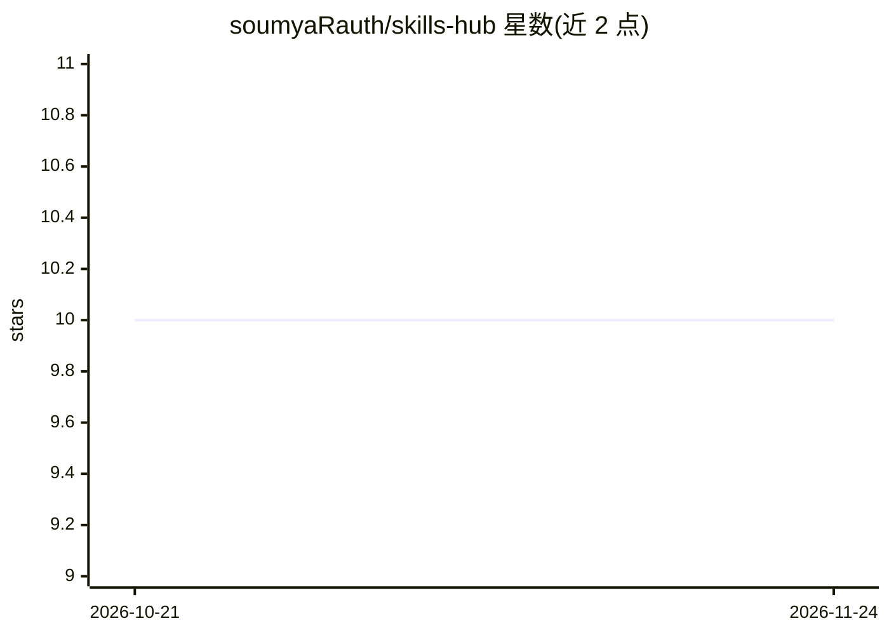

# soumyaRauth/skills-hub

⭐ 10 · Python · MIT · 推送 2026-11-17 · [GitHub](https://github.com/soumyaRauth/skills-hub) · [官网](https://soumyarauth.github.io/skills-hub/) · 个人维护

**为 Claude Code 等 Agent 提供软件工程技能集合**

一组以 markdown 形式发布的 Agent Skills，共 19 个，覆盖变更影响分析、契约驱动开发、上线前验证、工程调查、依赖审查、架构决策、项目启动、交付规划、发布与可观测性基线等环节，另含共情评估技能与项目知识 MCP 服务器。通过 Skills CLI（npx）安装，可整体装/卸，支持 Claude Code 及其他兼容 Agent Skills 的 agent；技能按描述自动激活，带激活评测套件与本地 Runway 提示估算工具。不提供托管服务。

## 筛选速览

| 维度 | 判定 | 备注 |
|---|---|---|
| AI 角色 | `ai-ecosystem` | LLM/agent 周边工具 |
| 许可风险 | `permissive` | MIT |
| 部署形态 | `library` | 以包/库形式分发 |
| 模型依赖 | — | README 未给出锁定关系 |
| 硬件要求 | — | 无带数字的原话,不猜 |
| 安装摩擦 | `low` | 无编译、无系统依赖或容器化 |
| 成熟度 | — | 结构信号不足 |

## 能力要点

- 19 个可组合、可独立使用的工程技能，含 SKILL.md 安全评级（Skills Directory 扫描）
- 技能由 agent 根据描述自动加载，附 evals/activation 激活评测（30/38，加指令后 37/38）
- project-knowledge 通过 MCP 服务器向后续开发者提供项目知识
- 一条命令整体安装/卸载，不影响其他技能

## 适用场景

- 让编码 agent 在写代码前后自动做影响分析与上线验证
- 从想法到规格、工单、发布走通单人开发流程
- 对软件做标准/安全/无障碍合规审计

## 场景标签

`编码 Agent` `代码审查` · 领域:编码与开发

## 证据(README 行号)

> L14: **Agent Skills for real engineering work.** Installable with the Skills CLI, and usable with
> L15: Claude Code and other agents that support Agent Skills. No hosted service: markdown, one optional MCP server that s
> L42: ## 🧰 The skills

## 星数曲线

2026-10-21 10 → 2026-11-24 10（+0）

---
*卡片 v1 · prompt 1.4 · 生成 2026-11-19 · 置信度 high · 依据 README sha `47fec1f7f3b4` · [字段定义](../../DATASET.md)*
