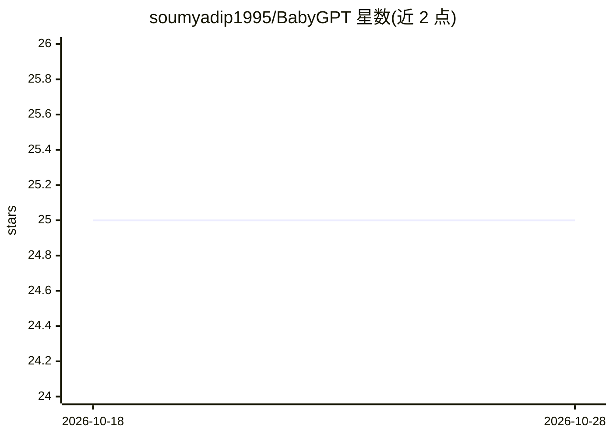

# soumyadip1995/BabyGPT

⭐ 25 · Jupyter Notebook · GPL-3.0 · 推送 2026-01-13 · [GitHub](https://github.com/soumyadip1995/BabyGPT) · 个人维护

**供学习用的小规模 GPT 实现，从 bigram 到 LLaMA 逐层拆解**

基于 Karpathy 的 ng-video-lectures 与 mingpt 构建的教学型小规模 GPT（256/16 输出通道、5 层、注意力手工实现），配套从 bigram/ngram 到 transformer 再到 GPT 的渐进路线图与系列 notebook。提供 15M/42M 等多个小模型（参数量 13k–6.37M），在 TinyStories 数据与 Tesla T4 上训练；含 LoRA 低秩近似、int8 量化（模型缩小约 4 倍）、性能基准与 lit-llama/LLaMA2 的移植实现，并有机制可解释性 notebook。以源码和 Colab notebook 形式提供，附论文。

## 筛选速览

| 维度 | 判定 | 备注 |
|---|---|---|
| AI 角色 | `ai-native` | 本体是模型或模型工具 |
| 许可风险 | `viral` | GPL-3.0 |
| 部署形态 | `None` |  |
| 模型依赖 | — | README 未给出锁定关系 |
| 硬件要求 | — | 无带数字的原话,不猜 |
| 安装摩擦 | `medium` | 含编译或系统依赖之一 |
| 成熟度 | — | 结构信号不足 |

## 能力要点

- 注意力机制手工实现的小规模 GPT（13k–6.37M 参数）
- LoRA 低秩近似与 int8 量化（尺寸缩小约 4 倍）
- lit-llama / LLaMA v1 / LLaMA2 移植实现，含 MFU 计算
- bigram→ngram→transformer→GPT 的渐进教学路线与 Colab notebook

## 适用场景

- 从零逐步理解 transformer 内部机制
- 在小模型上做量化、LoRA 等压缩实验
- 复现并修改小规模 GPT 训练流程

## 场景标签

`教程课程` · 领域:学习与行业

## 证据(README 行号)

> L14: Building on the intuition of Karpathy's ng-video-lectures and mingpt, BabyGPT provides a working model of a GPT on 
> L31: If you wish to understand the nitty gritty of how transformers work from scratch, this roadmap will guide you. We s

## 星数曲线

2026-10-18 25 → 2026-10-28 25（+0）

---
*卡片 v1 · prompt 1.4 · 生成 2026-10-26 · 置信度 high · 依据 README sha `1d6c2f45bed7` · [字段定义](../../DATASET.md)*
