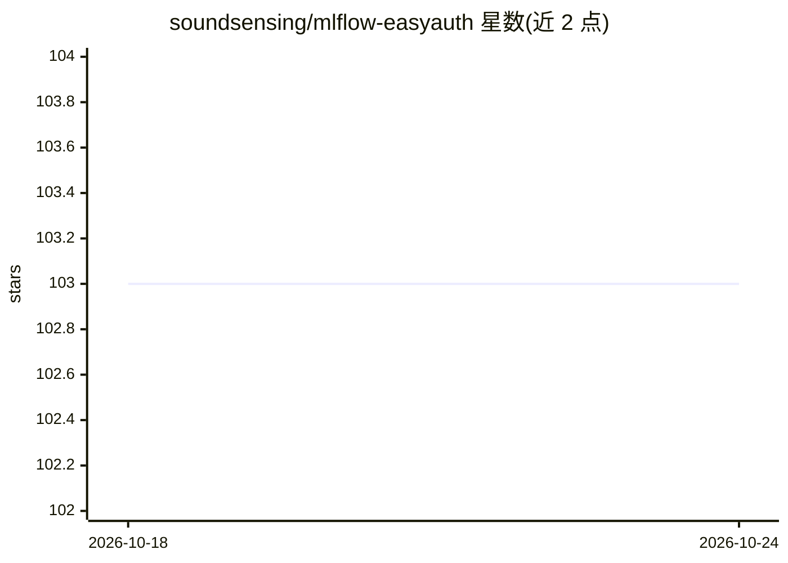

# soundsensing/mlflow-easyauth

⭐ 103 · Shell · Apache-2.0 · 推送 2026-01-13 · [GitHub](https://github.com/soundsensing/mlflow-easyauth) · 组织维护

**给旧版 MLflow 加 HTTP basic auth 的 Docker 部署方案**

面向需要部署 MLflow tracking server 的开发者：在 MLflow 2.5.0 之前无认证的 web 界面与 API 前加单一用户名/密码的 HTTP basic 认证，并打包为 Docker 镜像。支持 Docker volume 持久化，可选配置 Google Cloud Storage 作为 artifact 存储、Heroku Postgres 作为 tracking store，全部通过环境变量配置。README 顶部声明：MLflow 官方自 2023 年起已支持认证，建议改用官方方案；本项目状态为很少使用、不再积极维护。

## 筛选速览

| 维度 | 判定 | 备注 |
|---|---|---|
| AI 角色 | `ai-ecosystem` | LLM/agent 周边工具 |
| 许可风险 | `permissive` | Apache-2.0 |
| 部署形态 | `self-host` | docker 或自建部署 |
| 模型依赖 | — | README 未给出锁定关系 |
| 硬件要求 | — | 无带数字的原话,不猜 |
| 安装摩擦 | `low` | 无编译、无系统依赖或容器化 |
| 成熟度 | — | 结构信号不足 |

## 能力要点

- 为 MLflow 2.5.0 之前的 web 界面与 API 加 HTTP basic 认证
- 打包为 Docker 镜像，环境变量完成全部配置
- 可选 Google Cloud Storage artifact 存储与 PostgreSQL metrics 持久化
- 官方 MLflow 已内置认证，README 建议改用官方方案

## 适用场景

- 为旧版 MLflow tracking server 部署加一层访问认证
- 在 Docker 提供商（Heroku、Fly.io、ECS 等）上部署带认证的 MLflow
- 搭配 GCS 与 Postgres 做集中式实验跟踪

## 场景标签

`MLOps` · 领域:训练与推理

## 证据(README 行号)

> L10: This project adds basic HTTP authentication with a **single username, password** to the web interface and API.
> L11: And packages this up in a easy-to-install Docker image.

## 星数曲线

2026-10-18 103 → 2026-10-24 103（+0）

---
*卡片 v1 · prompt 1.4 · 生成 2026-10-23 · 置信度 high · 依据 README sha `32768c6d298e` · [字段定义](../../DATASET.md)*
