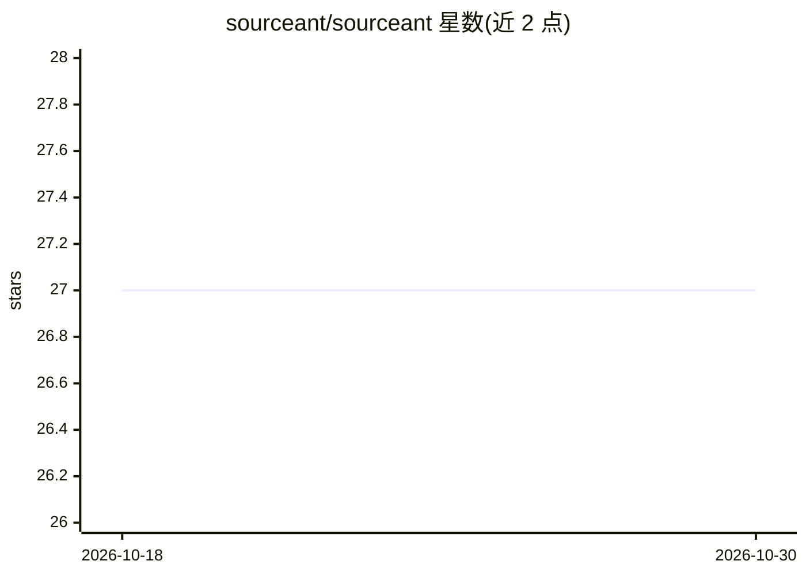

# sourceant/sourceant

⭐ 27 · Python · MIT · 推送 2026-10-23 · [GitHub](https://github.com/sourceant/sourceant) · [官网](https://sourceant.ai) · 组织维护

**为 AI 编码代理提供持久记忆与代码图谱的 MCP 服务器**

SourceAnt 将仓库解析为文件、符号及其关系的代码图谱，并通过 MCP 协议提供给 Claude Code、Cursor、Codex、Gemini CLI 等编码工具。它在会话间保存决策、规则、需求与系统拓扑等知识，并与对应代码建立关联；同一审查引擎既可在本地对工作区做代码审查，也可在代码托管平台上审查 PR，并支持跨仓库影响检查。核心以 MIT 许可发布并可完全自托管，另有 SourceAnt Cloud 托管层（团队记忆、契约分析、持续索引、工作区与角色等）。通过 CLI 安装脚本与三条命令即可开始首次审查。

## 筛选速览

| 维度 | 判定 | 备注 |
|---|---|---|
| AI 角色 | `ai-ecosystem` | LLM/agent 周边工具 |
| 许可风险 | `permissive` | MIT |
| 部署形态 | `None` |  |
| 模型依赖 | — | README 未给出锁定关系 |
| 硬件要求 | — | 无带数字的原话,不猜 |
| 安装摩擦 | `low` | 无编译、无系统依赖或容器化 |
| 成熟度 | — | 结构信号不足 |

## 能力要点

- 仓库解析为文件/符号/关系的本地代码图谱，单一本地存储管理多仓库
- 通过 MCP 提供知识、需求、拓扑、技能等工具集，供编码工具调用
- 同一审查引擎支持本地工作区审查与 PR 审查，并可跨仓库检查变更影响
- 知识以自然语言记录（决策/规则/需求），存续于会话之间并关联代码

## 适用场景

- 让我的编码代理记住项目决策、规则与 API 契约，跨会话保持一致
- 在提交前用与 PR 相同的审查器在本地检查工作区
- 当一个仓库的变更可能破坏其他仓库时做跨仓库审查
- 在 Claude Code / Cursor 等支持 MCP 的工具中检索代码与项目知识

## 场景标签

`代码审查` `知识图谱` `Agent 记忆` · 领域:Agent 开发

## 证据(README 行号)

> L65: SourceAnt parses your repositories into one graph and serves it over MCP, so
> L54: |`sourceant mcp`|Connect an MCP client over standard input and output|

## 星数曲线

2026-10-18 27 → 2026-10-30 27（+0）

---
*卡片 v1 · prompt 1.4 · 生成 2026-10-26 · 置信度 high · 依据 README sha `70fbdf11ef1e` · [字段定义](../../DATASET.md)*
