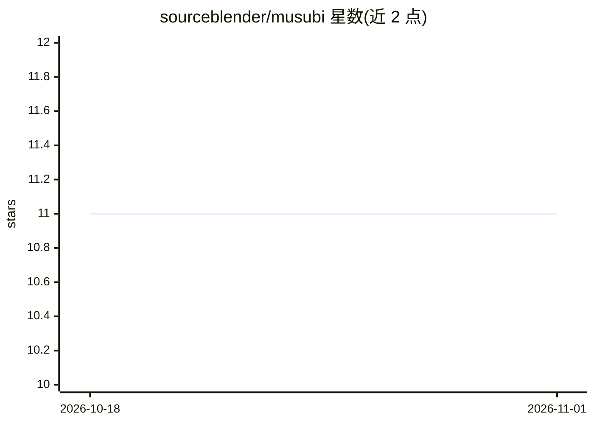

# sourceblender/musubi

⭐ 11 · Python · Apache-2.0 · 推送 2026-10-31 · [GitHub](https://github.com/sourceblender/musubi) · [官网](https://github.com/sourceblender/musubi) · 个人维护

**多 AI Agent 共享记忆服务器：三层记忆与生命周期引擎**

面向运行多个 AI agent 场景的独立 Python 记忆服务：以 HTTP API 为唯一接口，核心持有记忆模型，Claude Code/Codex/OpenClaw/LiveKit 等集成以插件形式接入。记忆分 Episodic/Concept/Curated 三层，由定时生命周期引擎完成成熟、聚类综合、晋升与 Obsidian 库同步，人工可审核编辑。检索采用 Qdrant 混合搜索（BGE-M3 稠密 + SPLADE 稀疏 + BGE 重排），LLM 调用走 Ollama 或 OpenAI 兼容端点。Docker Compose 部署，镜像 cosign 签名并附 SBOM。

## 筛选速览

| 维度 | 判定 | 备注 |
|---|---|---|
| AI 角色 | `ai-ecosystem` | LLM/agent 周边工具 |
| 许可风险 | `permissive` | Apache-2.0 |
| 部署形态 | `desktop` | 安装包/桌面程序 |
| 模型依赖 | local-ok | 支持本地模型 |
| 硬件要求 | — | 无带数字的原话,不猜 |
| 安装摩擦 | `low` | 无编译、无系统依赖或容器化 |
| 成熟度 | — | 结构信号不足 |

## 能力要点

- Episodic/Concept/Curated 三层记忆与定时生命周期引擎（成熟/综合/晋升/降级）
- Qdrant 混合检索：稠密 BGE-M3 + 稀疏 SPLADE + BGE 重排，一次调用跨层
- Thoughts 作为一等消息通道，agent 可 send/subscribe，支持 Last-Event-ID 重放
- 晋升内容渲染为 markdown 写入 Obsidian 库，人工编辑经 vault sync 回流

## 适用场景

- 多个 agent 共享同一记忆基底，一个学到的知识其他 agent 可用
- 将 agent 摄取的原始内容逐步成熟为人工可审核的知识库
- 以命名空间与 JWT 作用域隔离不同 agent 的记忆租户

## 场景标签

`Agent 记忆` · 领域:Agent 开发

## 证据(README 行号)

> L12: Musubi (結び — *"to tie, to join, to bind"*) is a memory server built for the moment when a single AI assistant is no
> L14: It is a standalone Python service with an HTTP API. Agent integrations (Claude Code, Codex, OpenClaw, LiveKit and o
> L46: - **Ollama** for LLM calls (maturation scoring, synthesis, promotion rendering, reflection). You choose the model w

## 星数曲线

2026-10-18 11 → 2026-11-01 11（+0）

---
*卡片 v1 · prompt 1.4 · 生成 2026-11-01 · 置信度 high · 依据 README sha `cb27da7bf564` · [字段定义](../../DATASET.md)*
