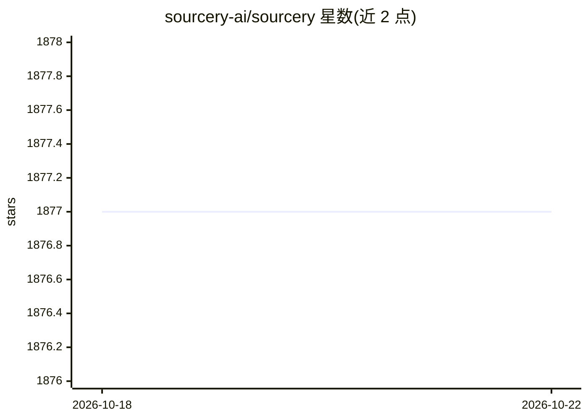

# sourcery-ai/sourcery

⭐ 1,877 · MIT · 推送 2026-10-21 · [GitHub](https://github.com/sourcery-ai/sourcery) · [官网](https://sourcery.ai) · 组织维护

**面向 GitHub 仓库的 AI 自动代码审查服务，另含 IDE 助手**

Sourcery 是由 Sourcery 团队提供的自动化代码审查服务：对任意 GitHub 仓库的 pull request 生成即时审查，输出变更摘要、整体反馈与逐行建议，使用 OpenAI 与 Anthropic 的 LLM 完成部分审查内容，需将 PR diff 片段发送给模型方，但声明代码不存储超过 30 天且不用于训练。公共仓库免费使用，私有仓库提供 14 天试用后需 Team 或 Pro 付费计划。另提供 IDE 内的辅助编程功能，支持 PyCharm、VS Code、Sublime、Vim 集成。README 未给出本地安装或运行命令。

## 筛选速览

| 维度 | 判定 | 备注 |
|---|---|---|
| AI 角色 | `ai-native` | 本体是模型或模型工具 |
| 许可风险 | `permissive` | MIT |
| 部署形态 | `None` |  |
| 模型依赖 | — | README 未给出锁定关系 |
| 硬件要求 | — | 无带数字的原话,不猜 |
| 安装摩擦 | `low` | 无编译、无系统依赖或容器化 |
| 成熟度 | — | 结构信号不足 |

## 能力要点

- 对任意 GitHub 仓库的 PR 生成摘要、整体反馈与逐行建议
- 使用 OpenAI 与 Anthropic LLM，声明代码不存储超 30 天、不用于训练
- 公共仓库/开源项目免费，私有仓库 14 天试用后需付费计划
- IDE 辅助功能：解释代码、生成单元测试与 docstring、优化建议

## 适用场景

- 为团队 PR 流程接入自动代码审查获取即时反馈
- 在 IDE 中让助手补充单元测试和 docstring
- 开源项目零成本获得 PR 审查

## 场景标签

`代码审查` · 领域:编码与开发

## 证据(README 行号)

> L13: Sourcery is an automated code reviewer that will review any pull request on any GitHub repository to provide instan

## 星数曲线

2026-10-18 1,877 → 2026-10-22 1,877（+0）

---
*卡片 v1 · prompt 1.4 · 生成 2026-10-21 · 置信度 high · 依据 README sha `1eb5c407c768` · [字段定义](../../DATASET.md)*
