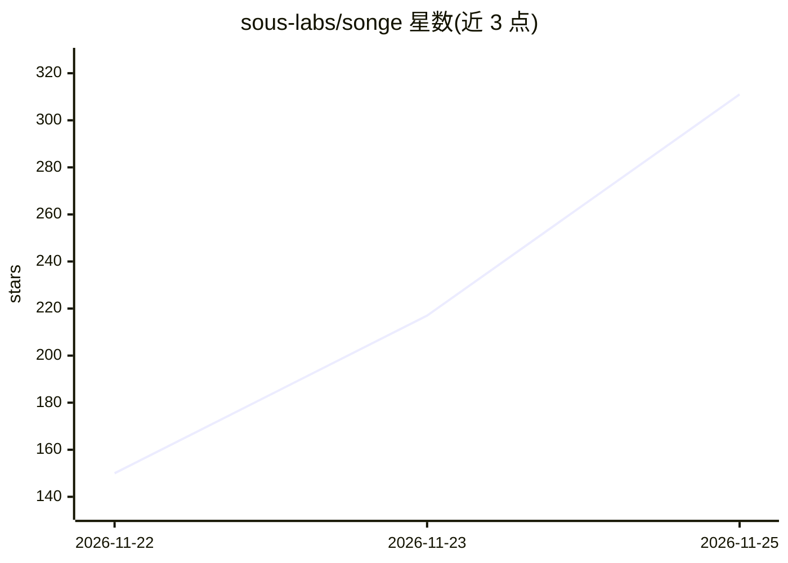

# sous-labs/songe

⭐ 311 · Python · Apache-2.0 · 推送 2026-11-23 · [GitHub](https://github.com/sous-labs/songe) · [官网](https://souslabs.ai/songe) · 组织维护

**利用闲置算力在本地微调你本地模型的学习引擎**

Songe 以本地代理与模型服务器之间的中间层运行（127.0.0.1:7613），记录代理会话中的纠正、偏好与工具错误作为学习素材；代理空闲时通过 Quick Dream（数分钟内把偏好写入模型指令）或 Deep Dream（基于 on-policy distillation 训练小型适配器）更新模型，新版仅在通过对比检查后启用，可一键回滚。数据不出本机，无账号与遥测。安装依赖 uv/pipx 或 Homebrew，需要本地模型服务器与代理配合使用。

## 筛选速览

| 维度 | 判定 | 备注 |
|---|---|---|
| AI 角色 | `ai-ecosystem` | LLM/agent 周边工具 |
| 许可风险 | `permissive` | Apache-2.0 |
| 部署形态 | `library` | 以包/库形式分发 |
| 模型依赖 | local-ok | 支持本地模型 |
| 硬件要求 | — | 无带数字的原话,不猜 |
| 安装摩擦 | `low` | 无编译、无系统依赖或容器化 |
| 成熟度 | — | 结构信号不足 |

## 能力要点

- 从代理会话中提取纠正、偏好与工具错误作为训练素材
- Quick Dream 与 Deep Dream 两种更新方式，新版仅在检查通过后启用
- 基于 on-policy distillation 训练小型适配器，并含回放与判分机制
- 仅在代理空闲、内存与电量条件满足时运行，支持一键回滚与卸载还原

## 适用场景

- 让本地编码代理模型从日常使用中的纠正与报错持续学习
- 在闲置时段自动训练模型且不影响正常工作
- 希望训练数据留在本机、不上云的个人用户

## 场景标签

`微调` · 领域:训练与推理

## 证据(README 行号)

> L3:  A training engine for your local model, using your idle compute.
> L16: Use your local model as usual through opencode, pi or any OpenAI-compatible
> L85: |Model servers|LM Studio, vLLM, Ollama, llama.cpp, mlx-lm|LM Studio (macOS), vLLM (Linux)|

## 星数曲线

2026-11-22 150 → 2026-11-25 311（+161）

---
*卡片 v1 · prompt 1.4 · 生成 2026-11-25 · 置信度 high · 依据 README sha `ab44a84f304d` · [字段定义](../../DATASET.md)*
