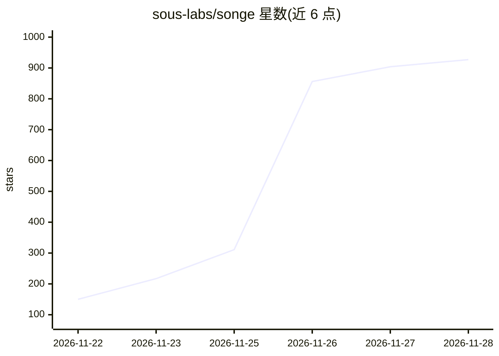

# sous-labs/songe

⭐ 927 · Python · Apache-2.0 · 推送 2026-11-27 · [GitHub](https://github.com/sous-labs/songe) · [官网](https://souslabs.ai/songe) · 组织维护

**为本地模型训练 LoRA 的空闲算力微调引擎**

Songe 以 OpenAI 兼容代理的形式部署在本地 agent 与模型服务器之间，记录模型的每次行为结果，在 agent 空闲时用这些记录训练 LoRA 适配器。提供 Quick Dream（将偏好加入指令）与 Deep Dream（on-policy 蒸馏训练）两种模式，新版本仅在自查明确更好时启用，可一键回退。数据默认全部留在本机，云端学习为可选开关。训练需 Apple Silicon（MLX）或 NVIDIA/AMD GPU，无 GPU 时仅作代理与记录。安装方式为 uv/pipx/Homebrew。

## 筛选速览

| 维度 | 判定 | 备注 |
|---|---|---|
| AI 角色 | `ai-ecosystem` | LLM/agent 周边工具 |
| 许可风险 | `permissive` | Apache-2.0 |
| 部署形态 | `library` | 以包/库形式分发 |
| 模型依赖 | local-ok | 支持本地模型 |
| 硬件要求 | — | 无带数字的原话,不猜 |
| 安装摩擦 | `low` | 无编译、无系统依赖或容器化 |
| 成熟度 | — | 结构信号不足 |

## 能力要点

- OpenAI 兼容代理：拦截 agent 与模型服务器间的流量并记录教训
- Quick Dream 与 Deep Dream 两种学习模式，含 on-policy 蒸馏训练
- 新版本仅在对比检查明确更好后启用，支持一键回退
- 默认本地运行，无账户无遥测，云端学习需显式开启

## 适用场景

- 让本地编码 agent 从我的纠正和工具错误中持续学习
- 在电脑空闲时段自动微调自己日常使用的本地模型
- 训练前后自动对比，只保留表现更好的模型版本

## 场景标签

`微调` `模型评测` · 领域:评测与运维

## 证据(README 行号)

> L18: Songe is a training engine for the model you already run locally. It sits
> L19: between your agent and your model server as an OpenAI-compatible proxy, logs
> L20: how each of the model's actions turned out, and fine-tunes a LoRA adapter on

## 星数曲线

2026-11-22 150 → 2026-11-28 927（+777）

---
*卡片 v1 · prompt 1.4 · 生成 2026-11-26 · 置信度 high · 依据 README sha `66b45d829c2c` · [字段定义](../../DATASET.md)*
