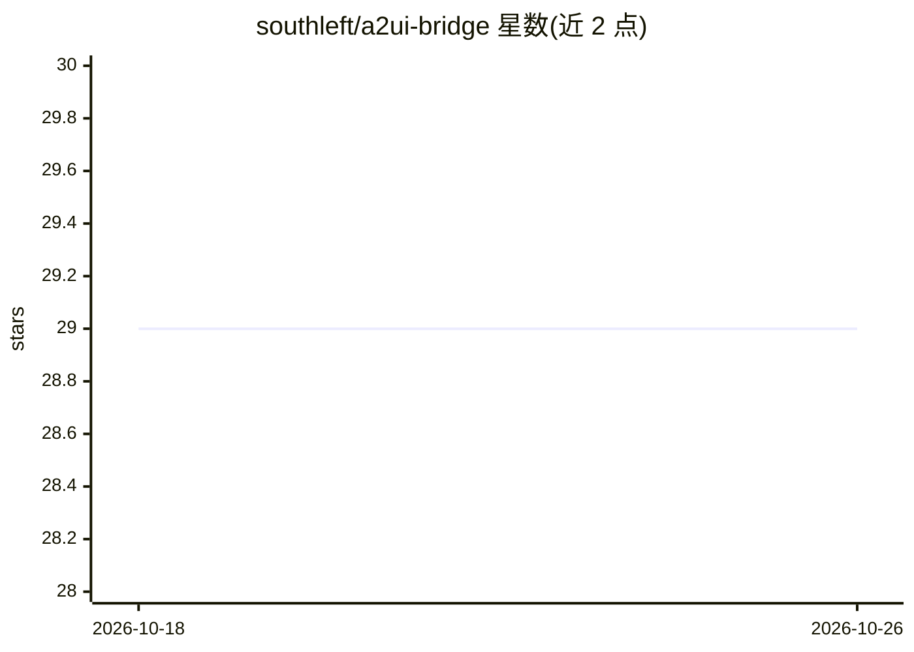

# southleft/a2ui-bridge

⭐ 29 · TypeScript · MIT · 推送 2026-09-09 · [GitHub](https://github.com/southleft/a2ui-bridge) · [官网](https://a2ui.southleft.com/) · 个人维护

**让 AI agent 用任意组件库生成真实 UI 的 A2UI 协议 React 适配框架**

实现 Google A2UI (Agent-to-UI) 协议的 React 框架：AI agent 输出声明式 JSON 描述 UI 结构，A2UI Bridge 通过适配器将其渲染为 Mantine、ShadCN 或自定义组件库的真实组件，同一 JSON 可跨库渲染。提供协议处理/状态管理/数据绑定的 core 包、React hooks 与 Surface 组件，以及 Mantine（77 个适配器）和 ShadCN（76 个适配器）两套设计系统适配包。支持 70+ 组件类型、数据模型绑定、流式渐进渲染，JSON 非可执行代码。附可本地运行的 demo，支持切换 Claude/GPT/Gemini 多模型。

## 筛选速览

| 维度 | 判定 | 备注 |
|---|---|---|
| AI 角色 | `ai-ecosystem` | LLM/agent 周边工具 |
| 许可风险 | `permissive` | MIT |
| 部署形态 | `library` | 以包/库形式分发 |
| 模型依赖 | — | README 未给出锁定关系 |
| 硬件要求 | — | 无带数字的原话,不猜 |
| 安装摩擦 | `low` | 无编译、无系统依赖或容器化 |
| 成熟度 | — | 结构信号不足 |

## 能力要点

- 同一份 A2UI JSON 可渲染到 Mantine、ShadCN 或自定义组件库
- 提供 70+ 组件类型适配器（Mantine 77 个、ShadCN 76 个）
- 声明式 JSON 而非可执行代码，UI 随 AI 生成渐进构建
- 组件支持数据模型绑定与 action 上下文携带

## 适用场景

- 让 Claude/GPT/Gemini 等 agent 在我的应用里动态生成界面
- 同一 AI 输出在不同设计系统间复用而无需改 prompt
- 为聊天类产品添加由 agent 实时构建的表单与卡片 UI

## 场景标签

`Agent 框架` · 领域:Agent 开发

## 证据(README 行号)

> L5: A2UI Bridge implements Google's A2UI Protocol for React, enabling AI-generated UIs that render with your existing de
> L177: AI Agent (Claude, GPT, Gemini, etc.)

## 星数曲线

2026-10-18 29 → 2026-10-26 29（+0）

---
*卡片 v1 · prompt 1.4 · 生成 2026-10-26 · 置信度 high · 依据 README sha `c03e2568e4df` · [字段定义](../../DATASET.md)*
