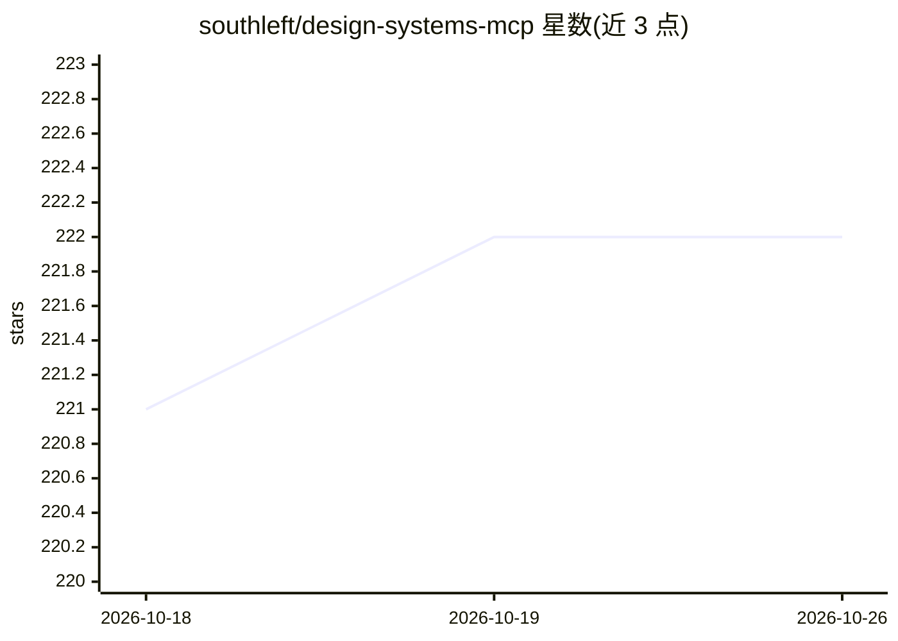

# southleft/design-systems-mcp

⭐ 222 · TypeScript · NOASSERTION · 推送 2026-09-10 · [GitHub](https://github.com/southleft/design-systems-mcp) · [官网](https://design-systems-mcp.southleft.com/) · 个人维护

**给 AI 编码工具的设计系统知识库 MCP 服务器**

基于 Model Context Protocol 的知识检索服务器：收录 395 条策展条目，覆盖 W3C/WCAG 标准、ARIA、主流设计系统（Carbon、Polaris、Material 3、Fluent 等）以及 2025-2026 的 agent 界面协议（A2UI、MCP Apps SEP-1865、AG-UI）。提供向量+关键词搜索（Supabase pgvector，Cloudflare Workers AI bge-m3，OpenAI 可选）、按类别/标签浏览、来源可靠性标注等 5 个 MCP 工具，以及基于 Llama 3.3 70B 的聊天界面。可直接连接公共端点无需安装，也支持本地开发（git clone + npm）与部署到 Cloudflare Workers。提供 Claude Desktop、Cursor、Cline、Zed 等客户端的接入说明。

## 筛选速览

| 维度 | 判定 | 备注 |
|---|---|---|
| AI 角色 | `ai-knowledge` | 知识聚合/清单类 |
| 许可风险 | `none` | NOASSERTION |
| 部署形态 | `library` | 以包/库形式分发 |
| 模型依赖 | — | README 未给出锁定关系 |
| 硬件要求 | — | 无带数字的原话,不猜 |
| 安装摩擦 | `low` | 无编译、无系统依赖或容器化 |
| 成熟度 | — | 结构信号不足 |

## 能力要点

- 395 条策展条目：W3C 标准、WCAG 2.2、ARIA、主流设计系统与 agent 界面协议
- 向量+关键词双路检索，含相关性下限（未覆盖主题返回空而非相邻内容）
- 公共 MCP 端点零安装接入，5 个 MCP 工具（搜索/分块检索/分类浏览/标签）
- 提供 URL/PDF/CSV 内容摄取脚本与 Supabase 向量搜索架构

## 适用场景

- 在 AI 编码工具中查询设计系统规范与可访问性指南
- 获取 agent 界面协议（A2UI、MCP Apps）的最新字段与迁移信息
- 自建一套可检索的设计系统知识库并部署到 Cloudflare Workers

## 场景标签

`语义搜索` `精选清单` · 领域:知识与检索

## 证据(README 行号)

> L3: An AI-powered Model Context Protocol (MCP) server providing intelligent access to authoritative design systems knowl
> L17: - 📚 **395 Curated Entries** - W3C standards, WCAG 2.2, ARIA practices, major design systems, and agent-interface pr
> L36: ### 395 Curated Entries Including:

## 星数曲线

2026-10-18 221 → 2026-10-26 222（+1）

---
*卡片 v1 · prompt 1.4 · 生成 2026-10-22 · 置信度 high · 依据 README sha `9c551d834a2f` · [字段定义](../../DATASET.md)*
