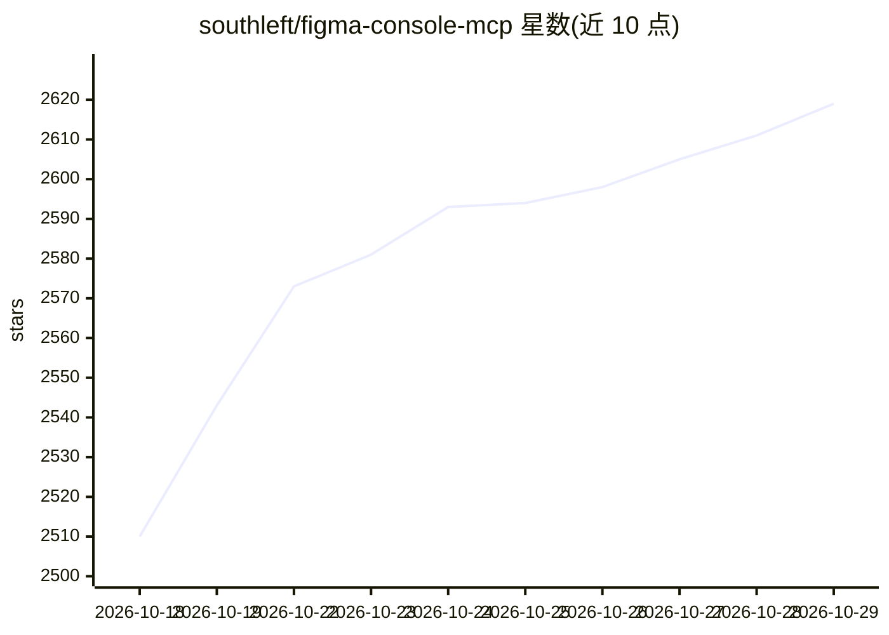

# southleft/figma-console-mcp

⭐ 2,619 · TypeScript · MIT · 推送 2026-10-28 · [GitHub](https://github.com/southleft/figma-console-mcp) · [官网](https://southleft.com) · 个人维护

**连接 AI 与 Figma 的双向设计系统 MCP 服务器**

面向设计系统场景的 Model Context Protocol 服务器，将 AI 助手（如 Claude）接入 Figma，支持双向操作：读取/提取变量、组件与样式，写出组件、帧与令牌到 Figma，并提供确定性检查（设计-代码一致性、14 项 WCAG 无障碍扫描、设计系统健康审计）。支持从代码库反向挖掘设计令牌。提供 NPX、Cloud Mode、Remote SSE、Local Git 四种接入方式，共 121 个工具（NPX 模式），需要 Node.js 18+ 与 Figma Desktop 桥接插件实现完整写入能力。

## 筛选速览

| 维度 | 判定 | 备注 |
|---|---|---|
| AI 角色 | `ai-ecosystem` | LLM/agent 周边工具 |
| 许可风险 | `permissive` | MIT |
| 部署形态 | `library` | 以包/库形式分发 |
| 模型依赖 | — | README 未给出锁定关系 |
| 硬件要求 | — | 无带数字的原话,不猜 |
| 安装摩擦 | `low` | 无编译、无系统依赖或容器化 |
| 成熟度 | — | 结构信号不足 |

## 能力要点

- Figma⇄code 双向操作：提取令牌/组件并支持创建、修改与全量同步
- 121 个工具（NPX 模式），含 FigJam、Slides、版本历史 blame
- 14 项 WCAG 无障碍检查与 Lighthouse 式设计系统健康审计
- 四种连接方式：Remote SSE / Cloud Mode / NPX / Local Git

## 适用场景

- 让 AI 助手在 Figma 中创建组件并管理设计令牌
- 对 Figma 组件与代码实现做确定性一致性比对
- 把生产代码库的样式挖掘为 DTCG 设计令牌并回流 Figma
- 对设计系统做命名、令牌覆盖与无障碍的健康审计

## 场景标签

 · 领域:设计工具/AI 集成

## 证据(README 行号)

> L9: > **Your design system as an API.** A design-system-focused Model Context Protocol server for Figma. It works in bot
> L15: Figma Console MCP connects AI assistants (like Claude) to Figma, enabling:
> L32: - **🔄 Four ways to connect** - Remote SSE, Cloud Mode, NPX, or Local Git

## 星数曲线

2026-10-18 2,510 → 2026-10-29 2,619（+109）

---
*卡片 v1 · prompt 1.4 · 生成 2026-10-21 · 置信度 high · 依据 README sha `2ca397c0ae22` · [字段定义](../../DATASET.md)*
