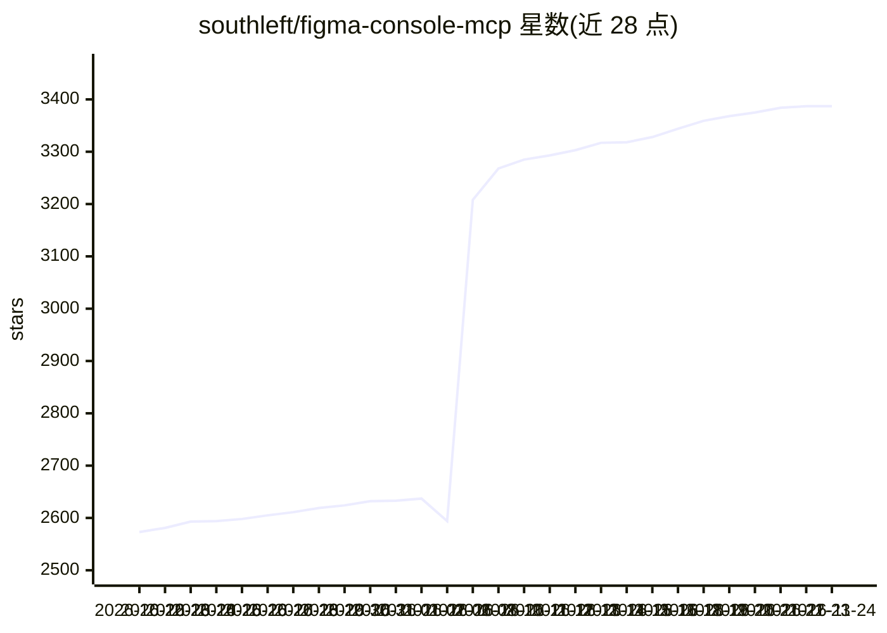

# southleft/figma-console-mcp

⭐ 3,387 · TypeScript · MIT · 推送 2026-11-13 · [GitHub](https://github.com/southleft/figma-console-mcp) · [官网](https://southleft.com) · 组织维护

**把设计系统暴露为 API 的 Figma MCP 服务器，供 AI 读取与写入 Figma**

面向 Figma 的 Model Context Protocol 服务器，支持双向操作：从 Figma 提取变量、组件与样式为 DTCG 等结构化 token，也能由 AI 在 Figma 中创建组件、Frame 与布局。提供 130 个工具（Cloud Mode 105 个），覆盖设计-代码一致性检查、14 项 WCAG 可访问性扫描、设计系统健康审计、版本历史与 FigJam/Slides 操作。通过 Remote SSE、Cloud Mode、NPX 或本地 Git 四种方式接入 Claude Desktop、Claude Code、Cursor 等客户端；写操作需 Node.js 18+ 与 Figma Desktop 及 Desktop Bridge 插件。

## 筛选速览

| 维度 | 判定 | 备注 |
|---|---|---|
| AI 角色 | `ai-ecosystem` | LLM/agent 周边工具 |
| 许可风险 | `permissive` | MIT |
| 部署形态 | `library` | 以包/库形式分发 |
| 模型依赖 | — | README 未给出锁定关系 |
| 硬件要求 | — | 无带数字的原话,不猜 |
| 安装摩擦 | `low` | 无编译、无系统依赖或容器化 |
| 成熟度 | — | 结构信号不足 |

## 能力要点

- 130 个 MCP 工具，覆盖读取、创建、token 管理与审计
- 设计系统提取与代码库→设计系统反向提取（DTCG token + Storybook 脚手架）
- 确定性设计-代码一致性检查与 14 项 WCAG 可访问性扫描
- 四种连接方式：Remote SSE、Cloud Mode、NPX、Local Git

## 适用场景

- 让 AI 助手直接读写 Figma 设计稿与设计 token
- 对 Figma 组件与对应代码做一致性与可访问性核查
- 从生产代码库反推设计系统并回写 Figma 变量
- 在 Claude.ai/v0 等 Web 客户端通过 Cloud Mode 远程操作设计

## 场景标签

 · 领域:设计工具/AI 接入层

## 证据(README 行号)

> L9: > **Your design system as an API.** A design-system-focused Model Context Protocol server for Figma. It works in bot
> L15: Figma Console MCP connects AI assistants (like Claude) to Figma, enabling:
> L32: - **🔄 Four ways to connect** - Remote SSE, Cloud Mode, NPX, or Local Git

## 星数曲线

2026-10-22 2,573 → 2026-11-24 3,387（+814）

---
*卡片 v1 · prompt 1.4 · 生成 2026-11-23 · 置信度 high · 依据 README sha `567969605252` · [字段定义](../../DATASET.md)*
