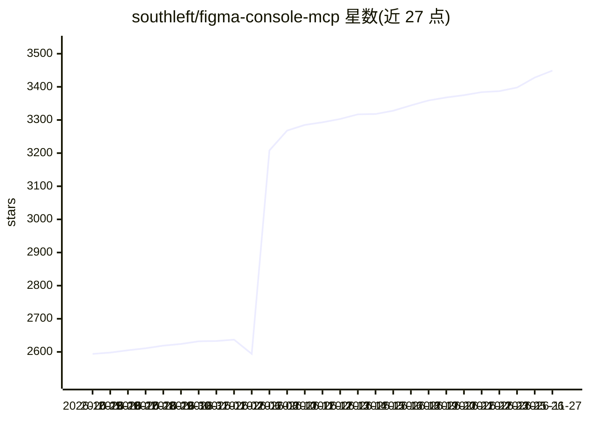

# southleft/figma-console-mcp

⭐ 3,449 · TypeScript · MIT · 推送 2026-11-26 · [GitHub](https://github.com/southleft/figma-console-mcp) · [官网](https://southleft.com) · 组织维护

**面向设计师与开发者的 Figma 设计系统 MCP 服务器**

一个以设计系统为核心的 Model Context Protocol 服务器，连接 AI 客户端与 Figma，支持双向操作（读取与写入 Figma）。提供设计系统变量/组件/样式提取、DTCG token 双向同步、代码库反向提取设计系统、设计-代码一致性确定性检查、14 项 WCAG 无障碍扫描、组件文档生成与版本历史追踪等工具。NPX/本地模式提供 144 个工具，Cloud Mode 提供 113 个，Remote SSE 为只读子集。需 Node.js 18+ 与 Figma Desktop（NPX/本地模式）。

## 筛选速览

| 维度 | 判定 | 备注 |
|---|---|---|
| AI 角色 | `ai-ecosystem` | LLM/agent 周边工具 |
| 许可风险 | `permissive` | MIT |
| 部署形态 | `library` | 以包/库形式分发 |
| 模型依赖 | — | README 未给出锁定关系 |
| 硬件要求 | — | 无带数字的原话,不猜 |
| 安装摩擦 | `low` | 无编译、无系统依赖或容器化 |
| 成熟度 | — | 结构信号不足 |

## 能力要点

- 144 个 MCP 工具，覆盖 Figma 读取、写入、token 管理、FigJam 与 Slides 操作
- 双向 token 同步：导出 DTCG JSON 等 10 种格式，可回写 Figma 变量
- 确定性设计-代码一致性对比与 14 项 WCAG 无障碍检查
- 工具按 toolsets 分组加载，每条消息 token 定义占用从 ~60k 降至 ~9k

## 适用场景

- 让 AI 直接读取并按团队设计系统生成/修改 Figma 设计
- 扫描现有代码库反向提取 DTCG token 并搭建设计系统包
- 对生成的 Figma 与代码做设计-代码一致性与无障碍审计
- 导出 Figma 变量为设计 token 并与代码侧双向同步

## 场景标签

`代码审查` · 领域:编码与开发

## 证据(README 行号)

> L9: > **Your design system as an API.** A design-system-focused Model Context Protocol server for Figma. It works in bot
> L35: - **🔄 Four ways to connect** - Remote SSE, Cloud Mode, NPX, or Local Git
> L63: |**Total tools available**|**144**|**113** after pairing|Read-only subset|

## 星数曲线

2026-10-25 2,594 → 2026-11-27 3,449（+855）

---
*卡片 v1 · prompt 1.4 · 生成 2026-11-27 · 置信度 high · 依据 README sha `ad2720978e9e` · [字段定义](../../DATASET.md)*
