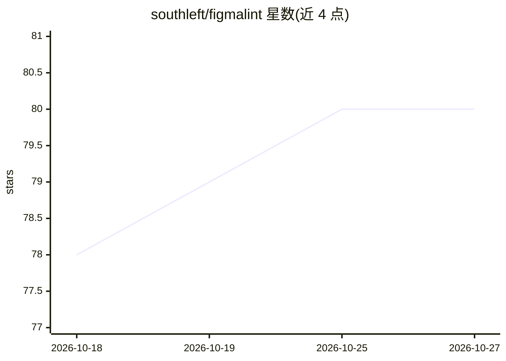

# southleft/figmalint

⭐ 80 · TypeScript · ISC · 推送 2026-10-26 · [GitHub](https://github.com/southleft/figmalint) · [官网](https://southleft.com) · 组织维护

**面向设计系统团队的 Figma 插件：AI 审计组件合规性与可访问性**

Figma 社区插件，用多种 AI 提供商（Anthropic/OpenAI/Google/OpenRouter，支持 Azure OpenAI 自有部署路由）分析选中的组件：检测缺失交互状态、按 WCAG 评估对比度/触控目标/焦点指示，识别设计 token 与硬编码值并提供绑定修复，生成结构化组件描述与开发者交付文档（Markdown/AI Prompt/JSON）。提供设计系统对话问答、实例文档网格、审计评分与自动修复（token 绑定、图层重命名、批量操作）。API key 存于 Figma 本地存储，组件数据不外存；需自备提供商 API key。

## 筛选速览

| 维度 | 判定 | 备注 |
|---|---|---|
| AI 角色 | `ai-enhanced` | 去掉 AI 部分产品仍成立 |
| 许可风险 | `permissive` | ISC |
| 部署形态 | `library` | 以包/库形式分发 |
| 模型依赖 | locked-api |  |
| 硬件要求 | — | 无带数字的原话,不猜 |
| 安装摩擦 | `low` | 无编译、无系统依赖或容器化 |
| 成熟度 | — | 结构信号不足 |

## 能力要点

- 多提供商 AI 分析，可切换模型，支持 Azure OpenAI 自有部署路由与 OpenRouter 单 key 多模型
- WCAG 可访问性检查与组件就绪度加权评分
- 设计 token 检测与 AI 辅助自动修复（模糊匹配、变量作用域感知）
- 三种导出格式（Markdown/AI Prompt/JSON）用于开发者交付与 AI 代码生成

## 适用场景

- 设计系统团队审计 Figma 组件的 token 使用与命名规范
- 组件交付前检查可访问性（对比度、触控目标、焦点）
- 为开发者或 AI 编码工具生成结构化组件规范文档

## 场景标签

 · 领域:设计工具/设计系统

## 证据(README 行号)

> L3: An AI-powered Figma plugin that audits components for design system compliance, accessibility, and developer readine
> L29: - Evaluates accessibility against WCAG standards — contrast ratio, touch target size, focus indicators, font size
> L90: - **Markdown** — Comprehensive documentation with variants table, properties API, property quick reference, states 

## 星数曲线

2026-10-18 78 → 2026-10-27 80（+2）

---
*卡片 v1 · prompt 1.4 · 生成 2026-10-24 · 置信度 high · 依据 README sha `196e874860b9` · [字段定义](../../DATASET.md)*
