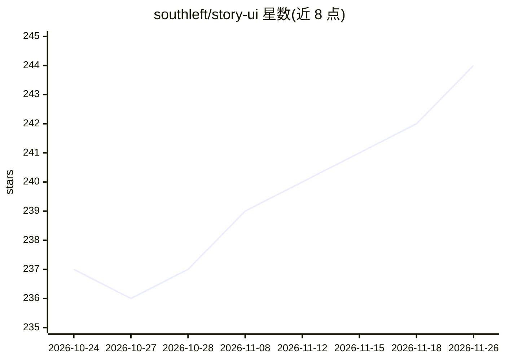

# southleft/story-ui

⭐ 244 · TypeScript · MIT · 推送 2026-11-13 · [GitHub](https://github.com/southleft/story-ui) · 个人维护

**在 Storybook 中用自然语言生成设计系统组件页面的工具**

嵌入现有 Storybook 的工作区：用户用自然语言描述界面，工具从项目中发现组件（类型声明、本地源码、Storybook index），生成 .stories.tsx 文件并渲染到 Storybook 预览。每个生成结果经过静态检查与真实浏览器渲染验证（内容溢出、重叠、空白检测），失败则重新生成。支持文本、图片、CSV、PDF 引用附件，直接属性编辑不调用模型，版本历史带 diff，可一键提交到新分支并开 PR。React+TypeScript 项目用完整工作区，Vue/Svelte/Angular/Web Components 用简化面板。

## 筛选速览

| 维度 | 判定 | 备注 |
|---|---|---|
| AI 角色 | `ai-enhanced` | 去掉 AI 部分产品仍成立 |
| 许可风险 | `permissive` | MIT |
| 部署形态 | `library` | 以包/库形式分发 |
| 模型依赖 | — | README 未给出锁定关系 |
| 硬件要求 | — | 无带数字的原话,不猜 |
| 安装摩擦 | `low` | 无编译、无系统依赖或容器化 |
| 成熟度 | — | 结构信号不足 |

## 能力要点

- 只使用项目已有组件，prop 按真实类型校验，虚构 token 被拒绝
- 生成后自动在真实浏览器渲染并测量验证，失败自动重生成
- 两种修改方式：对话回到模型，或 inspector 直接改属性不经模型
- 一键提交到新 git 分支并可开 PR，不污染当前分支

## 适用场景

- 设计师在真实设计系统中直接探索界面方案
- 设计系统团队确保组件被正确使用
- 工程师获得已导入正确组件的初稿代码
- 为 Vue/Svelte/Angular 项目生成 Storybook story

## 场景标签

`代码生成` · 领域:编码与开发

## 证据(README 行号)

> L8: Story UI adds a workspace to the Storybook you already have. You type what you
> L31: - **The output is real work.** Every generation is a `.stories.tsx` file in
> L83: |**A React + TypeScript design system**|An npm package or local source. Other frameworks get the classic panel — se

## 星数曲线

2026-10-24 237 → 2026-11-26 244（+7）

---
*卡片 v1 · prompt 1.4 · 生成 2026-11-25 · 置信度 high · 依据 README sha `98ee9d233aa7` · [字段定义](../../DATASET.md)*
