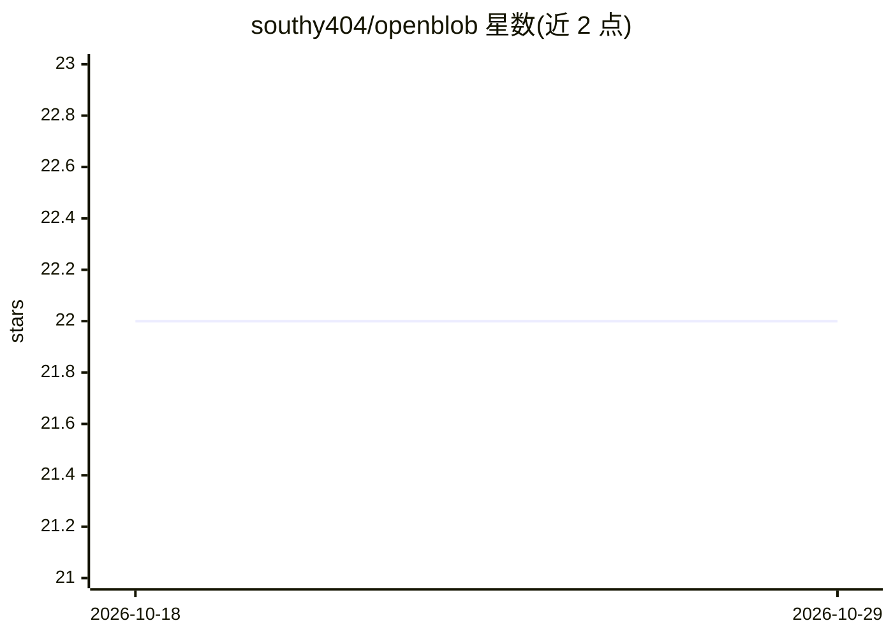

# southy404/openblob

⭐ 22 · Rust · NOASSERTION · 推送 2026-05-07 · [GitHub](https://github.com/southy404/openblob) · 个人维护

**Windows 本地优先 AI 桌面助手：语音/文字命令控制桌面**

基于 Tauri v2（Rust 后端+React UI）的 Windows 桌面 AI 伴侣应用：通过自然语言命令（英/德语）执行确定性系统控制（开应用、锁屏、关机确认流程）、浏览器导航、媒体播放、截图视觉分析与系统音频转录。语音部分支持 ALT+M 语音输入、本地 openWakeWord ONNX 唤醒词推理路径与 Piper 本地 TTS 分块朗读；本地记忆使用 SQLite 与可选嵌入检索。LLM 工作流依赖 Ollama。项目自述处于早期阶段，需从源码运行。

## 筛选速览

| 维度 | 判定 | 备注 |
|---|---|---|
| AI 角色 | `ai-native` | 本体是模型或模型工具 |
| 许可风险 | `none` | NOASSERTION |
| 部署形态 | `library` | 以包/库形式分发 |
| 模型依赖 | local-ok | 支持本地模型 |
| 硬件要求 | — | 无带数字的原话,不猜 |
| 安装摩擦 | `low` | 无编译、无系统依赖或容器化 |
| 成熟度 | `idea` | |

## 能力要点

- 确定性 Windows 系统控制与敏感电源命令的确认流程
- 本地 openWakeWord ONNX 唤醒词推理路径与 Piper 本地 TTS
- 系统音频实时转录及 AI 后处理（摘要/行动项）
- 截图视觉分析与受控上下文跟随命令

## 适用场景

- 用对话或语音命令操作 Windows 应用、浏览器和媒体播放
- 对会议、播客等系统音频做实时转录与摘要
- 通过 Telegram/Discord/Slack/Email 连接桌面助手

## 场景标签

`AI 助手` `GUI 自动化` `语音识别` · 领域:效率与自动化

## 证据(README 行号)

> L18: OpenBlob is a local-first AI companion that lives on your Windows desktop. It can respond to chat, understand your 
> L44: - Tauri v2 desktop app with Rust backend and React UI.
> L73: - Ollama for local LLM workflows

## 星数曲线

2026-10-18 22 → 2026-10-29 22（+0）

---
*卡片 v1 · prompt 1.4 · 生成 2026-10-27 · 置信度 mid · 依据 README sha `90811d905294` · [字段定义](../../DATASET.md)*
