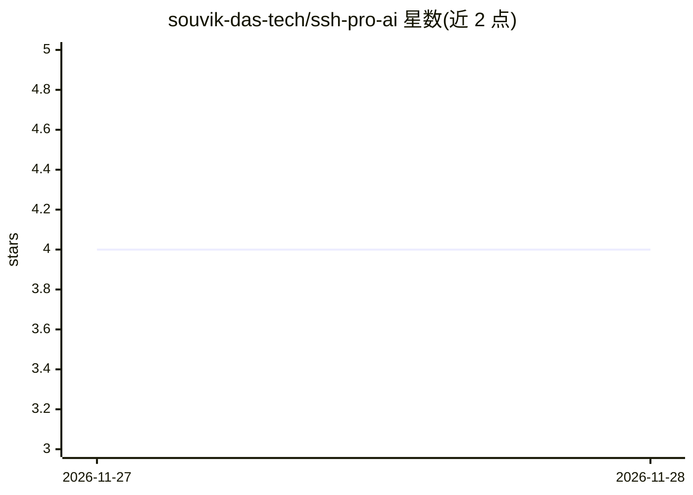

# souvik-das-tech/ssh-pro-ai

⭐ 4 · Rust · MIT · 推送 2026-11-25 · [GitHub](https://github.com/souvik-das-tech/ssh-pro-ai) · 个人维护

**Windows 上的 Linux 服务器群管理应用，带需审批的 AI 运维助手**

用 Rust 编写的 Windows 桌面 SSH 客户端与服务器群管理工具：集中管理多台 Linux 服务器（文件夹、标签、在线状态），提供 xterm.js 终端、批量广播输入、并行执行命令、服务器间文件/数据库传输、上传下载、审计日志与备份恢复。AI 部分通过本机 AGY CLI 接入 Gemini、Claude、GPT-OSS 模型，将自然语言请求转为 JSON 执行计划；应用侧用只读白名单校验命令，写操作需人工批准并按金丝雀顺序执行，输出经脱敏后才交给模型。SSH 终端与 Direct 模式无需 AI 即可使用。

## 筛选速览

| 维度 | 判定 | 备注 |
|---|---|---|
| AI 角色 | `ai-enhanced` | 去掉 AI 部分产品仍成立 |
| 许可风险 | `permissive` | MIT |
| 部署形态 | `desktop` | 安装包/桌面程序 |
| 模型依赖 | — | README 未给出锁定关系 |
| 硬件要求 | — | 无带数字的原话,不猜 |
| 安装摩擦 | `medium` | 含编译或系统依赖之一 |
| 成熟度 | — | 结构信号不足 |

## 能力要点

- AI 只生成计划：应用自带只读白名单决定是否直接执行，写操作需人工批准
- 金丝雀式变更发布（先一台服务器，再其余）
- SSH 密钥与密码用 Windows DPAPI 加密，IP/密码/密钥不发给模型，输出脱敏
- Auto 模式本地按请求类型在 Fast/Smart 两档模型间分流

## 适用场景

- 从一个 Windows 应用统一管理几十台 Linux 服务器
- 用自然语言让 AI 计划并分批执行全 fleet 的变更（如 Node.js 安全补丁）
- 多终端广播输入与并行只读巡检（磁盘空间、软件版本）
- 跨服务器复制文件或流式传输数据库备份

## 场景标签

`工作流自动化` · 领域:效率与自动化

## 证据(README 行号)

> L32:  (**Direct** mode, no AI needed).
> L63: work right away; only the AI chat needs the AGY CLI.
> L38: - 🛡️ **Safe by design**: an allowlist decides what counts as read-only. Everything else waits for

## 星数曲线

2026-11-27 4 → 2026-11-28 4（+0）

---
*卡片 v1 · prompt 1.4 · 生成 2026-11-27 · 置信度 high · 依据 README sha `599a99ecb303` · [字段定义](../../DATASET.md)*
