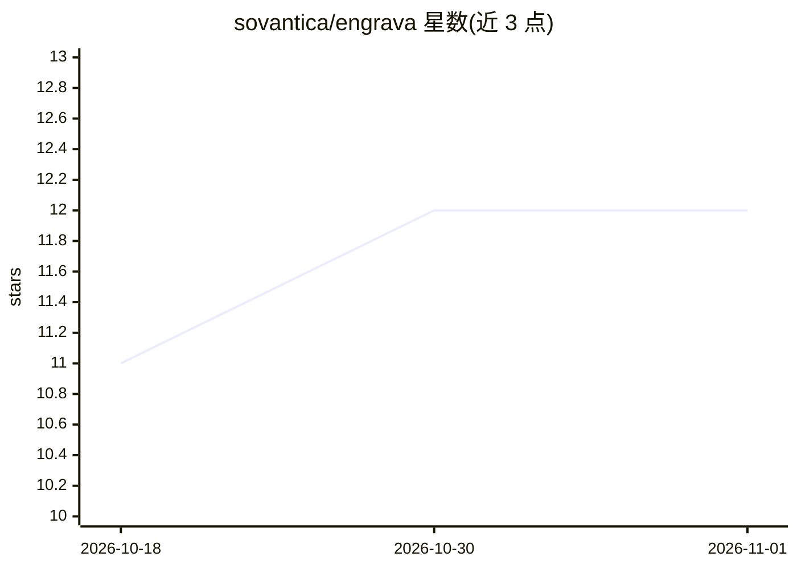

# sovantica/engrava

⭐ 12 · Python · MIT · 推送 2026-10-26 · [GitHub](https://github.com/sovantica/engrava) · [官网](https://engrava.ai) · 组织维护

**面向 AI agent 的记忆数据库：SQLite 上的思维图与混合检索**

基于单一 SQLite 文件的进程内 Python 库，为 AI agent 提供持久记忆存储：thought CRUD、带类型边的知识图、向量相似度检索（NumPy 余弦或可选 sqlite-vec）、FTS5/BM25 全文检索，以及加权融合的混合检索与 MindQL 声明式查询语言。核心写入路径不调用生成式模型；Dreaming 整合与 Memory Hygiene 归档为可选功能，另含可选哈希链防篡改 journal。嵌入模型支持本地 sentence-transformers、OpenAI 兼容 API、Ollama、HuggingFace 等可插拔后端；另有独立 engrava-mcp 包以 MCP 服务器形式供 Claude Code、Cursor 等客户端接入。

## 筛选速览

| 维度 | 判定 | 备注 |
|---|---|---|
| AI 角色 | `ai-ecosystem` | LLM/agent 周边工具 |
| 许可风险 | `permissive` | MIT |
| 部署形态 | `library` | 以包/库形式分发 |
| 模型依赖 | local-ok | 支持本地模型 |
| 硬件要求 | — | 无带数字的原话,不猜 |
| 安装摩擦 | `high` | 编译与系统依赖俱全 |
| 成熟度 | — | 结构信号不足 |

## 能力要点

- thought CRUD 与带类型/权重的边式知识图（ASSOCIATED/DEPENDS_ON 等类型）
- 混合检索：FTS、向量、新近度、优先级、图连通性多信号加权
- MindQL 声明式查询语言与 EngravaHooksProtocol 生命周期扩展系统
- 可选 SHA-256 哈希链 journal 记录 thought/edge 变更并可验证
- 独立 engrava-mcp 包提供原生 stdio MCP 服务器

## 适用场景

- 为 AI agent 提供跨会话持久记忆与混合检索
- 个人知识库或带语义检索的对话存储
- 需要防篡改变更记录的思维图应用
- 通过 MCP 让 Claude Code / Cursor 等客户端共享记忆库

## 场景标签

`Agent 记忆` · 领域:Agent 开发

## 证据(README 行号)

> L12: **Engrava** is a standalone, in-process database for AI agent memory. Built on
> L13: SQLite, it provides thought CRUD, edge-based knowledge graphs, embedding-based
> L241: Want Engrava as a memory server for your agent? The MCP server ships as its own

## 星数曲线

2026-10-18 11 → 2026-11-01 12（+1）

---
*卡片 v1 · prompt 1.4 · 生成 2026-11-01 · 置信度 high · 依据 README sha `40e4186d7f62` · [字段定义](../../DATASET.md)*
