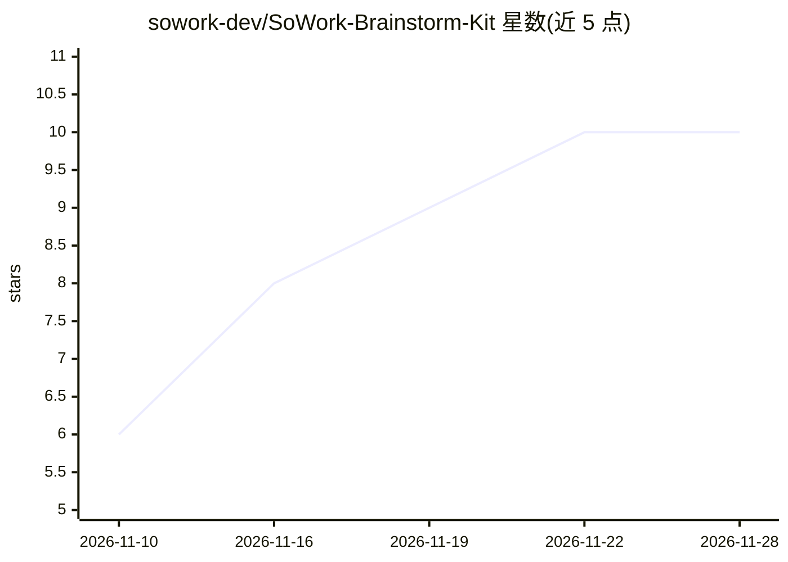

# sowork-dev/SoWork-Brainstorm-Kit

⭐ 10 · Python · NOASSERTION · 推送 2026-11-18 · [GitHub](https://github.com/sowork-dev/SoWork-Brainstorm-Kit) · 个人维护 · 中文 README

**面向营销者与创作者的多角色 AI 头脑风暴文本包**

一个可下载的文本包（MIT，公开预览），附加到 ChatGPT/Claude 会话后，AI 以虚构名人角色组成'议会'，按 LAZY_COUNCIL 模式提出创意、互相挑战并产出方向对比、推荐与首个小实验。含 31 张方法卡、中英繁双语包、自定义主题/阵容指令与 TEACHING 教学模式。无需安装、无需 Python 或 API key；也可作为 Claude Skill 通过 npx 安装。测试证据部分区分了人工编写示例与模型运行记录。

## 筛选速览

| 维度 | 判定 | 备注 |
|---|---|---|
| AI 角色 | `ai-native` | 本体是模型或模型工具 |
| 许可风险 | `permissive` | NOASSERTION |
| 部署形态 | `library` | 以包/库形式分发 |
| 模型依赖 | — | README 未给出锁定关系 |
| 硬件要求 | — | 无带数字的原话,不猜 |
| 安装摩擦 | `low` | 无编译、无系统依赖或容器化 |
| 成熟度 | `idea` | |

## 能力要点

- 虚构名人角色议会：提案、定向挑战、改进三轮机制
- 31 张方法卡支撑 LAZY_COUNCIL 模式，TEACHING 模式另行显式触发
- 中英繁双语包共享稳定的方法与角色 ID
- 可作 Claude Skill 一条命令安装（npx skills add）

## 适用场景

- 会前/路演前快速获得多视角创意与推荐方向
- 对现有发布计划做多角色压力测试
- 以中文或英文语言包开展创意共创
- 自定义主题与阵容（如五人导演组）定向发散

## 场景标签

`AI 写作` · 领域:内容生成

## 证据(README 行号)

> L14: Drop one text file into an AI chat and name a topic. A cast of famous **fictional** personas proposes ideas, challe
> L74: The reference library contains **31 method cards**, including related variants—not 31 independent theories. In the 
> L62: Marketers, founders, creators, and small teams who want a better first draft of thinking before a meeting, pitch, o

## 星数曲线

2026-11-10 6 → 2026-11-28 10（+4）

---
*卡片 v1 · prompt 1.4 · 生成 2026-11-20 · 置信度 high · 依据 README sha `300068564c3f` · [字段定义](../../DATASET.md)*
