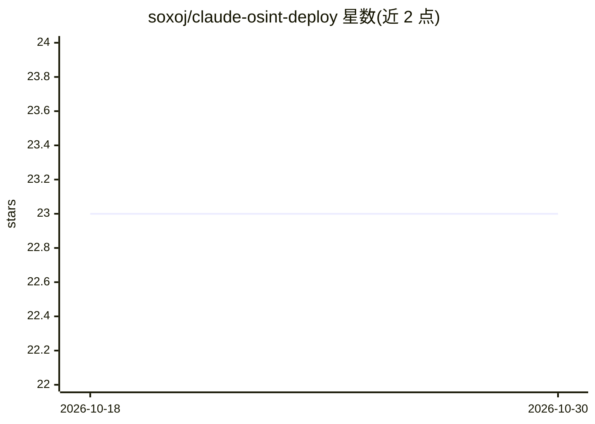

# soxoj/claude-osint-deploy

⭐ 23 · Python · MIT · 推送 2026-08-28 · [GitHub](https://github.com/soxoj/claude-osint-deploy) · 个人维护

**Claude Code 技能：自动安装并验证 GitHub 上的 OSINT 工具**

面向 Claude Code 的插件/技能：给定 GitHub 仓库，自动判断仓库类型（CLI、服务器、浏览器扩展、awesome-list 等）并选择安装路径（预编译二进制、Docker、隔离 Python 环境，Windows 下决定 WSL/Docker/原生），随后运行项目自身的测试套件与 README 示例命令做端到端验证，区分限流、缺 key 与真实安装失败。所学结果存为 recipe，便于重装。README 报告已检查约 65 个仓库、50 个工具端到端验证通过。本仓库运行仅依赖 python3（3.9+，仅标准库）与 git。

## 筛选速览

| 维度 | 判定 | 备注 |
|---|---|---|
| AI 角色 | `ai-ecosystem` | LLM/agent 周边工具 |
| 许可风险 | `permissive` | MIT |
| 部署形态 | `desktop` | 安装包/桌面程序 |
| 模型依赖 | — | README 未给出锁定关系 |
| 硬件要求 | — | 无带数字的原话,不猜 |
| 安装摩擦 | `low` | 无编译、无系统依赖或容器化 |
| 成熟度 | — | 结构信号不足 |

## 能力要点

- 按仓库类型自动选择安装策略（二进制/Docker/隔离 Python 环境）
- 运行项目自身 CI 测试与 README 示例做真实验证
- 区分限流、缺 key、需登录与真实安装失败并分别报告
- 验证结果存为 recipe，重装/跨机器一条命令完成

## 适用场景

- 让 Claude Code 自动装好一个 OSINT CLI 并证明它能跑
- 把重复的 OSINT 工具安装流程固化为可复用的 recipe
- 安装前先判断一个仓库是否真的可安装

## 场景标签

`网络安全` · 领域:学习与行业

## 证据(README 行号)

> L5:  Claude Code plugin/skill: install an OSINT tool from GitHub on any OS and prove it works.
> L29: You point it at a GitHub repo. It gets that tool running on your machine and then shows you proof

## 星数曲线

2026-10-18 23 → 2026-10-30 23（+0）

---
*卡片 v1 · prompt 1.4 · 生成 2026-10-27 · 置信度 mid · 依据 README sha `9b58c9813801` · [字段定义](../../DATASET.md)*
