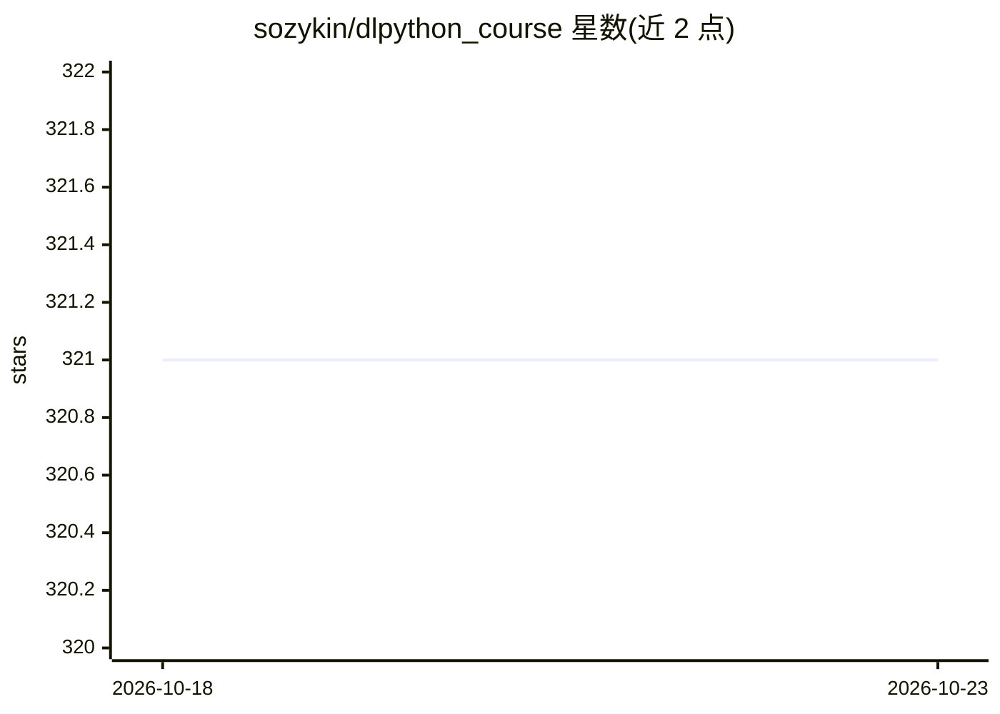

# sozykin/dlpython_course

⭐ 321 · Jupyter Notebook · 推送 2026-05-21 · [GitHub](https://github.com/sozykin/dlpython_course) · [官网](https://asozykin.ru/courses/nnpython) · 个人维护

**深度学习课程配套代码示例集（Keras/PyTorch）**

俄语课程《用 Python 编程深度神经网络》的示例代码仓库，按主题分目录：Keras/TensorFlow 基础（分类与回归）、CNN 图像分类、预训练网络、迁移学习、文本处理、RNN 与一维 CNN 文本分类、时间序列分析、Keras callbacks 等，另含已弃用示例的 archive 目录。课程页面提供视频讲座与实践作业。运行需 Python 3 及 TensorFlow、PyTorch 库。

## 筛选速览

| 维度 | 判定 | 备注 |
|---|---|---|
| AI 角色 | `ai-knowledge` | 知识聚合/清单类 |
| 许可风险 | `none` | — |
| 部署形态 | `None` |  |
| 模型依赖 | — | README 未给出锁定关系 |
| 硬件要求 | — | 无带数字的原话,不猜 |
| 安装摩擦 | `low` | 无编译、无系统依赖或容器化 |
| 成熟度 | — | 结构信号不足 |

## 能力要点

- 10 组示例覆盖分类、回归、CNN、迁移学习、RNN、时间序列
- 同时使用 Keras/TensorFlow 与 PyTorch 两个框架
- 配套视频讲座与实践作业的课程页面

## 适用场景

- 跟随课程学习深度神经网络编程
- 查找 Fashion-MNIST、California Housing 等数据集的标准示例
- 参考迁移学习与时间序列的 Keras/PyTorch 实现

## 场景标签

 · 领域:深度学习教育

## 证据(README 行号)

> L1: # Примеры программ для курса "Программирование глубоких нейронных сетей на Python"
> L7: 1. `01_introduction` - основы нейронных сетей на Keras и TensorFlow. Примеры задач классификации (распознавание моде

## 星数曲线

2026-10-18 321 → 2026-10-23 321（+0）

---
*卡片 v1 · prompt 1.4 · 生成 2026-10-21 · 置信度 high · 依据 README sha `c152e414f77a` · [字段定义](../../DATASET.md)*
