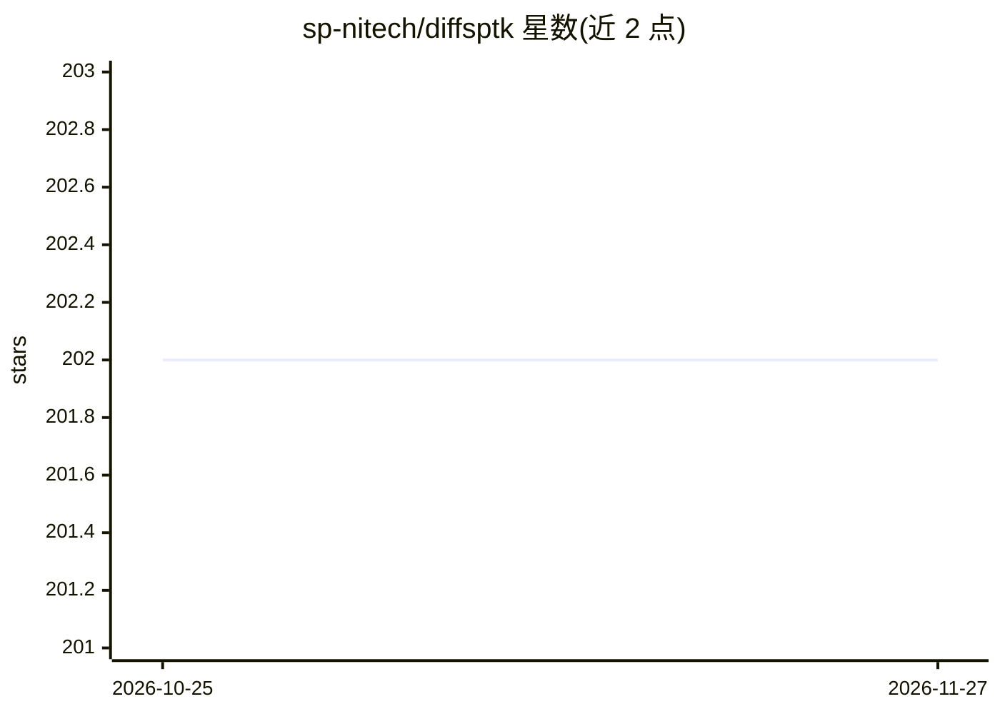

# sp-nitech/diffsptk

⭐ 202 · Python · Apache-2.0 · 推送 2026-11-26 · [GitHub](https://github.com/sp-nitech/diffsptk) · [官网](http://sp-tk.sourceforge.net) · 组织维护

**语音信号处理研究者的可微分 DSP 工具箱**

基于 PyTorch 构建的 SPTK 可微分版本，将经典语音信号处理算法封装为 PyTorch 层，使用户能把信号处理模块直接嵌入神经网络架构并通过反向传播优化。覆盖倒谱/LPC/LSP 分析合成、Mel 频谱、STFT、CQT、MDCT、滤波器组、子带分解、向量量化等模块。要求 Python 3.10+ 与 PyTorch 2.3.1+，通过 PyPI 或 GitHub 源码安装，并提供 Colab 交互教程与 API 参考手册。

## 筛选速览

| 维度 | 判定 | 备注 |
|---|---|---|
| AI 角色 | `ai-native` | 本体是模型或模型工具 |
| 许可风险 | `permissive` | Apache-2.0 |
| 部署形态 | `library` | 以包/库形式分发 |
| 模型依赖 | — | README 未给出锁定关系 |
| 硬件要求 | — | 无带数字的原话,不猜 |
| 安装摩擦 | `low` | 无编译、无系统依赖或容器化 |
| 成熟度 | — | 结构信号不足 |

## 能力要点

- 信号处理算法以 PyTorch 层形式提供，支持反向传播端到端优化
- 覆盖 LPC/PARCOR/Mel 倒谱/WORLD 等分析与合成模块
- 支持 GPU 运行（PyTorch CUDA 后端）
- 提供 Colab 交互教程与 ISCA 会议论文出处

## 适用场景

- 在语音合成/转换模型中嵌入可微分信号处理前端
- 对经典 DSP 参数进行基于梯度的优化
- 研究和复现 DDSP 类可微分信号处理方法

## 场景标签

 · 领域:语音/音频信号处理

## 证据(README 行号)

> L3: *diffsptk* is a differentiable version of SPTK built on the PyTorch framework.
> L4: It provides various speech signal processing modules as PyTorch layers,
> L5: allowing users to integrate classic signal processing algorithms directly into neural network architectures and opti

## 星数曲线

2026-10-25 202 → 2026-11-27 202（+0）

---
*卡片 v1 · prompt 1.4 · 生成 2026-11-25 · 置信度 high · 依据 README sha `11ed70c664db` · [字段定义](../../DATASET.md)*
