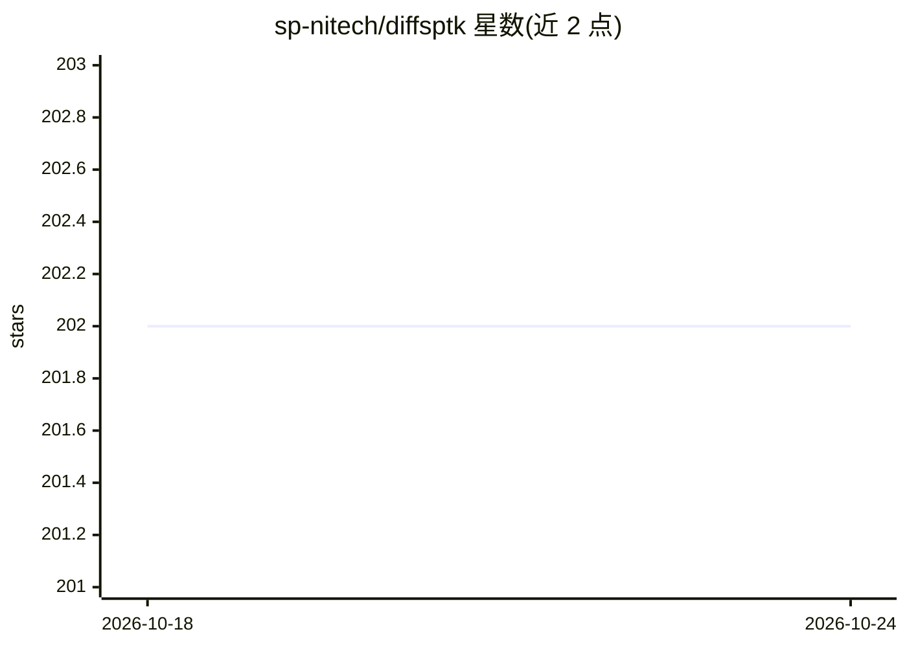

# sp-nitech/diffsptk

⭐ 202 · Python · Apache-2.0 · 推送 2026-10-22 · [GitHub](https://github.com/sp-nitech/diffsptk) · [官网](http://sp-tk.sourceforge.net) · 组织维护

**可微分语音信号处理工具库：SPTK 的 PyTorch 实现**

基于 PyTorch 的 SPTK 可微分版本，将倒谱分析、Mel 倒谱、LPC、WORLD 分析合成、常数 Q 变换、MDCT、子带分解、向量量化等经典语音信号处理算法实现为 PyTorch 层，可嵌入神经网络架构并通过反向传播优化。提供参考手册、Google Colab 交互教程与 ISCA 会议论文，要求 Python 3.10+ 与 PyTorch 2.3.1+，支持 GPU 运行，通过 PyPI 安装，Apache 2.0 许可。

## 筛选速览

| 维度 | 判定 | 备注 |
|---|---|---|
| AI 角色 | `ai-ecosystem` | LLM/agent 周边工具 |
| 许可风险 | `permissive` | Apache-2.0 |
| 部署形态 | `library` | 以包/库形式分发 |
| 模型依赖 | — | README 未给出锁定关系 |
| 硬件要求 | — | 无带数字的原话,不猜 |
| 安装摩擦 | `low` | 无编译、无系统依赖或容器化 |
| 成熟度 | — | 结构信号不足 |

## 能力要点

- SPTK 经典算法的 PyTorch 可微分实现
- 覆盖 Mel 倒谱、LPC、WORLD、CQT、MDCT、向量量化等模块
- 模块可作为神经网络层并通过反向传播优化
- 提供 Google Colab 交互教程与会议论文

## 适用场景

- 在语音神经网络中嵌入可微分的信号处理前端
- 教学与研究中对比经典 DSP 与深度学习方法
- 构建端到端可训练的语音分析合成流水线

## 场景标签

 · 领域:语音信号处理/深度学习

## 证据(README 行号)

> L3: *diffsptk* is a differentiable version of SPTK built on the PyTorch framework.
> L4: It provides various speech signal processing modules as PyTorch layers,

## 星数曲线

2026-10-18 202 → 2026-10-24 202（+0）

---
*卡片 v1 · prompt 1.4 · 生成 2026-10-22 · 置信度 high · 依据 README sha `04284c3f7090` · [字段定义](../../DATASET.md)*
