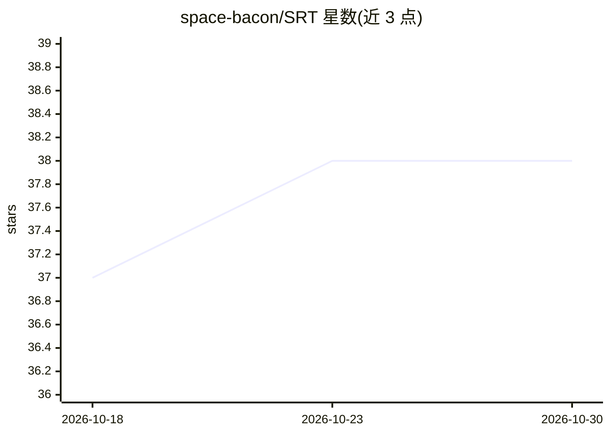

# space-bacon/SRT

⭐ 38 · Python · Apache-2.0 · 推送 2026-10-28 · [GitHub](https://github.com/space-bacon/SRT) · 个人维护

**读取冻结 LLM 隐状态的可移植适配器与探针架构**

SRT-Adapter 是一个约 12-14.6M 参数的轻量模块，附着在完全冻结的因果语言模型上：在 3 个层读取残差流（MAH），经 GRU 模块（RRM）整合后以 FiLM 形式在 2 个层注入修正，并输出逐 token 的 semiotic 信号（divergence、reflexivity r̂、regime）与话语/嵌入向量。背骨不可知，兼容任意 HuggingFace AutoModelForCausalLM。另含 TruthfulQA-MC2 冻结探针（LightGBM）、srt_select（无训练地从 K 个候选回复中选一）与跨模型/精度/硬件的可移植性测量。适配器侧信道未验证为幻觉检测器，README 明确标注其超范围。

## 筛选速览

| 维度 | 判定 | 备注 |
|---|---|---|
| AI 角色 | `ai-native` | 本体是模型或模型工具 |
| 许可风险 | `permissive` | Apache-2.0 |
| 部署形态 | `library` | 以包/库形式分发 |
| 模型依赖 | — | README 未给出锁定关系 |
| 硬件要求 | — | 无带数字的原话,不猜 |
| 安装摩擦 | `medium` | 含编译或系统依赖之一 |
| 成熟度 | — | 结构信号不足 |

## 能力要点

- 约 14.6M 参数适配器，背骨完全冻结，零交叉熵退化，数小时可训练
- 逐 token 输出 divergence、reflexivity r̂ 与 regime 信号，FiLM 注入修正
- 线性头读出结构在模型规模 3B→235B、bf16→4bit、数据中心 GPU→Apple Silicon 间保持不变
- srt_select 无训练、无参考答案地从 K 个模型回复中按输出分组选取（HumanEval 0.3762 / MBPP 0.8094）

## 适用场景

- 在冻结 LLM 上做可解释性研究与隐状态探测
- 用小模型配合 K 采样提升代码生成选择质量
- 研究跨厂商嵌入空间与跨模态检索的可移植性

## 场景标签

`模型评测` · 领域:评测与运维

## 证据(README 行号)

> L14: SRT-Adapter is the instrument: a lightweight module that bolts semiotic
> L23: > - **What:** a ~12 M-parameter adapter that observes a frozen LLM at 3 layers and injects a FiLM correction at 2 o
> L37: The base LLM stays fully frozen. SRT taps the residual stream at three

## 星数曲线

2026-10-18 37 → 2026-10-30 38（+1）

---
*卡片 v1 · prompt 1.4 · 生成 2026-10-25 · 置信度 mid · 依据 README sha `483d4cc30caf` · [字段定义](../../DATASET.md)*
