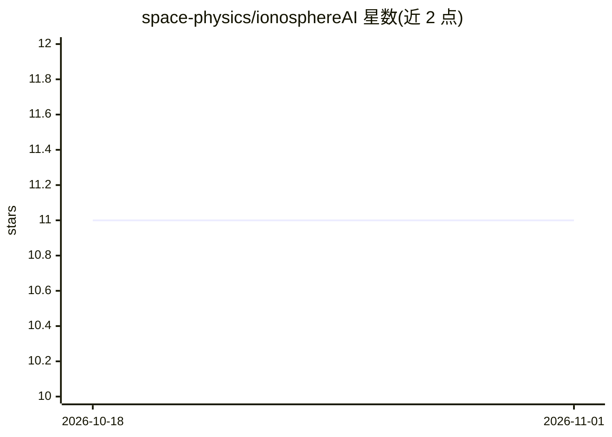

# space-physics/ionosphereAI

⭐ 11 · Python · Apache-2.0 · 推送 2026-10-08 · [GitHub](https://github.com/space-physics/ionosphereAI) · [官网](https://www.scivision.dev/passive-fm-radar-collective-behavior-detection/) · 个人维护

**电离层数据特征检测工具：极光视频与多类雷达数据**

面向空间物理研究者的机器学习/计算机视觉检测程序，用于极光视频、被动 FM 雷达、非相干散射雷达等地学数据中的集体行为特征检测。通过 python -m ionosphereAI.detect 命令运行，可处理整个目录的 .AVI 视频、单个文件或原始 ISR .dt3.h5 数据；读取能力依赖 OpenCV/imageio/FFmpeg，另支持 HiST 项目的专有二进制 .DMCdata 多 TB 视频文件。输出每帧极光检测数的 PNG 图与对应 HDF5 数据文件。程序与 OS/平台无关，以 pip 源码方式安装，未安装 OpenCV 时需另行安装 opencv-python。

## 筛选速览

| 维度 | 判定 | 备注 |
|---|---|---|
| AI 角色 | `ai-native` | 本体是模型或模型工具 |
| 许可风险 | `permissive` | Apache-2.0 |
| 部署形态 | `library` | 以包/库形式分发 |
| 模型依赖 | — | README 未给出锁定关系 |
| 硬件要求 | — | 无带数字的原话,不猜 |
| 安装摩擦 | `medium` | 含编译或系统依赖之一 |
| 成熟度 | — | 结构信号不足 |

## 能力要点

- 对极光视频、被动 FM 雷达、非相干散射雷达数据做特征检测
- 读取 OpenCV/imageio/FFmpeg 支持的任意视频格式及专有 .DMCdata 格式
- 输出逐帧检测数 PNG 图与 HDF5 数据文件
- 支持目录批处理与参数配置文件（如 dmc-gmm.json）

## 适用场景

- 我需要从 TB 级极光视频数据中定位感兴趣的检测片段
- 处理非相干散射雷达原始 .dt3.h5 数据并提取特征
- 批量扫描目录下多个 .AVI 视频并回放分析

## 场景标签

`图像视频处理` · 领域:感知与多模态

## 证据(README 行号)

> L6: Machine learning and computer vision techniques for auroral video, passive FM radar, incoherent scatter radar and ot
> L16: python -m ionosphereAI.detect ~/data/2013-05-01/isr -e .dt3.h5

## 星数曲线

2026-10-18 11 → 2026-11-01 11（+0）

---
*卡片 v1 · prompt 1.4 · 生成 2026-11-01 · 置信度 high · 依据 README sha `3bc2038e8904` · [字段定义](../../DATASET.md)*
