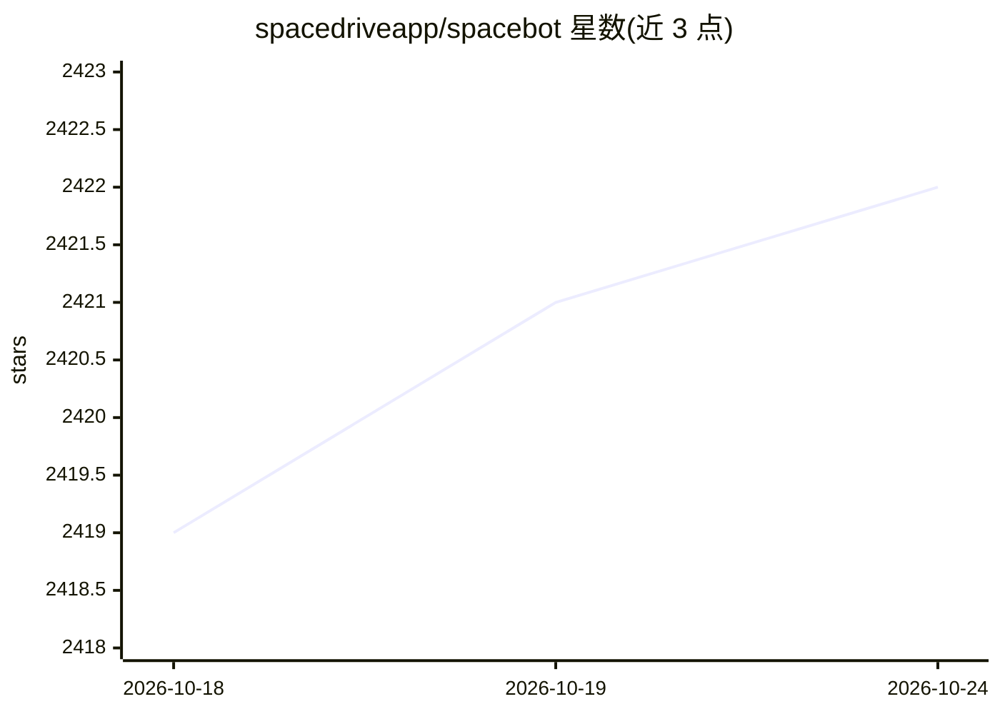

# spacedriveapp/spacebot

⭐ 2,421 · Rust · NOASSERTION · 推送 2026-09-25 · [GitHub](https://github.com/spacedriveapp/spacebot) · [官网](https://spacebot.sh) · 组织维护

**面向团队与社区的多线程 AI agent 编排基础设施**

用 Rust 编写的单体二进制 agent 基础设施，定位在单线程 agent harness 之上的一层：通道（Channels）负责对话且不可阻塞，分支（Branches）做思考，工作进程（Workers）执行实际任务，可驱动 OpenCode 等编码 agent 作为 worker。面向多用户场景：多人在 Discord/Slack/Telegram/Twitch 上共享同一记忆图与任务系统，权限按服务器/频道/私聊区分。支持 cron 与类型化事件唤醒的自主运行模式，任务需人工批准。本地优先、自托管，状态存于自带嵌入式数据库；提供 spacebot.sh 一键部署。

## 筛选速览

| 维度 | 判定 | 备注 |
|---|---|---|
| AI 角色 | `ai-ecosystem` | LLM/agent 周边工具 |
| 许可风险 | `none` | NOASSERTION |
| 部署形态 | `self-host` | docker 或自建部署 |
| 模型依赖 | — | README 未给出锁定关系 |
| 硬件要求 | — | 无带数字的原话,不猜 |
| 安装摩擦 | `low` | 无编译、无系统依赖或容器化 |
| 成熟度 | — | 结构信号不足 |

## 能力要点

- 四类进程架构：Channels/Branches/Workers/Compactor 分工且互不阻塞
- 多平台多用户共享记忆图，权限按 guild/channel/DM 粒度区分
- Chronicles 追加式检查点压缩，会话历史可导航并支持 worker 继承有界上下文
- 自主运行：goals + 类型化唤醒，任务落入 pending_approval 由人批准

## 适用场景

- 在 Discord/Slack 社区部署可同时服务几十名成员的 agent
- 团队在同一实例上并行运行多个 agent（社区 bot/开发助手/研究 agent）
- 让 agent 按计划、webhook 或审批事件自主执行后台任务

## 场景标签

`Agent 框架` `多智能体` `Agent 记忆` · 领域:Agent 开发

## 证据(README 行号)

> L5:  The multi-threaded agent harness. Built to run teams, communities, and companies.
> L44: Self-hosted, open source, local-first. One Rust binary, your own model keys, all state in embedded databases in a d

## 星数曲线

2026-10-18 2,419 → 2026-10-24 2,422（+3）

---
*卡片 v1 · prompt 1.4 · 生成 2026-10-21 · 置信度 mid · 依据 README sha `542f547412ee` · [字段定义](../../DATASET.md)*
